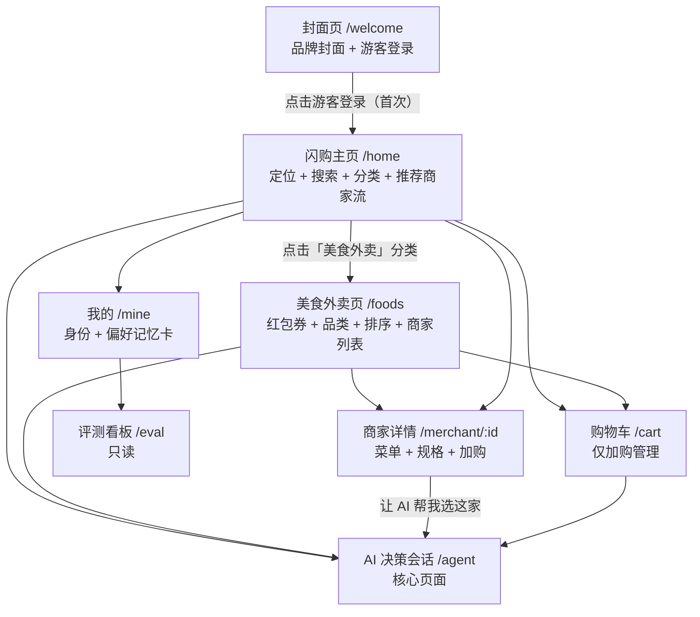
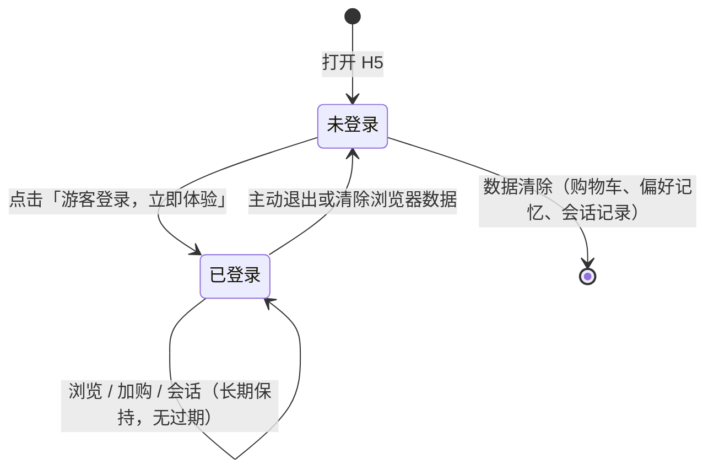
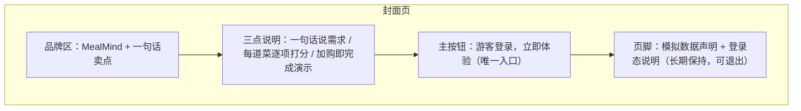
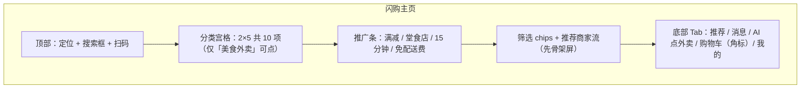
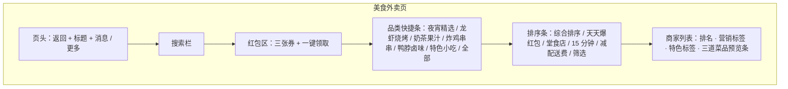
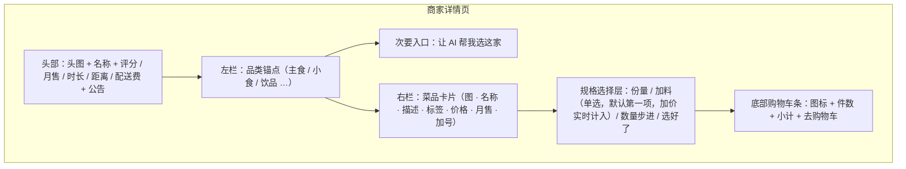
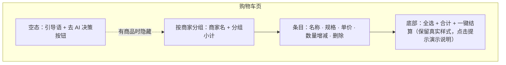
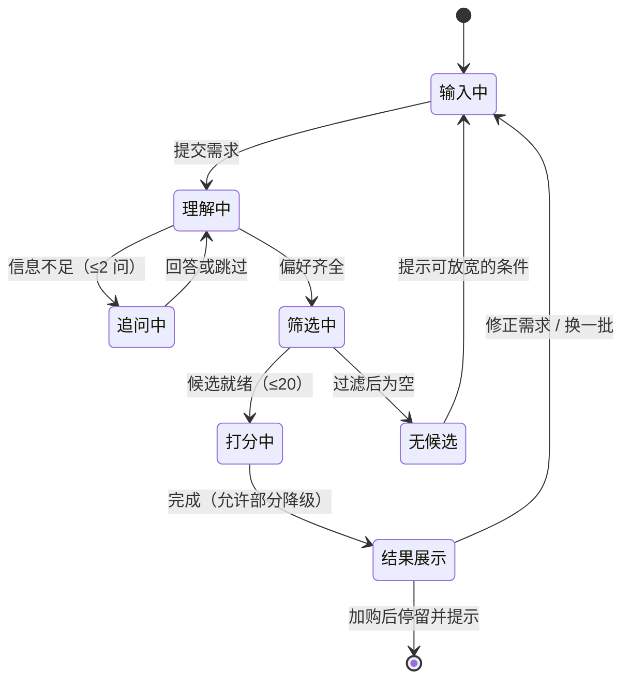
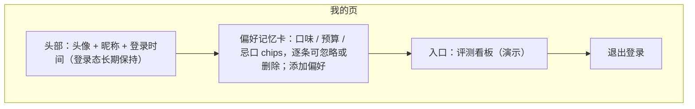
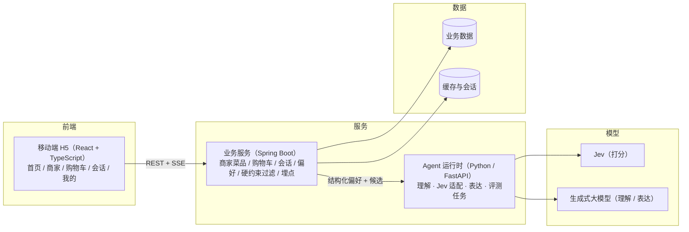

# MealMind · AI 外卖决策平台 PRD

2026-10-01 · 初稿（待评审）

本文有两个用途：指导开发；作为面试讲解材料。项目为个人作品集，商家与菜品全部是模拟数据，不含交易与结算。视觉风格参考淘宝闪购（截图后续补齐，不在本文范围）。

## 1. 背景与目标

### 1.1 为什么做这个项目

求职侧，目标岗位是 AI 全栈开发，需要一个新项目替换简历上的 HengPick，把「能设计并落地一条 AI 决策链路」讲清楚：能选型、能控成本与延迟、能对主观打分做评测。证据强度：明确（个人求职规划）。

用户侧，点外卖的选择成本长期存在：不知道吃什么、比价凑单耗时间、凑合吃完不满意。证据强度：[Hypothesis]（个人观察，未做用户调研）。

值得注意的行业变化是，主流平台已经把「一句话点外卖」做成了现实：美团小团覆盖含点外卖在内的 12 类本地生活需求、累计响应超过 7 亿次；千问接入淘宝闪购后可以一句话完成从需求到支付的流程（来源见第 3 章）。这些产品的共同点是给你结果卡片，但推荐依据不透明：为什么推这道菜、每道菜凭什么排在前面，用户看不到，也没有可核对的分数量级。

这个项目的切口就选在这里：推荐附带逐项评分与依据，硬性约束（预算、忌口、营业状态）由系统保证，整条决策链路做得可量化、可评测。规模上不与平台对标，对标点放在决策质量的可测量性。

### 1.2 目标

产品目标（演示期）：

1. 用户用一句自然语言说出需求，3 轮对话内拿到 3–5 个带评分与依据的候选，可直接加入购物车。
2. 硬性约束零违规：预算、忌口、营业状态三项不因模型判断失误而破例。
3. 每个分数可解释：能看到维度分、评分档位说明与置信度。
4. 决策成本与延迟可量化：单次决策成本、端到端 P95 在评测看板可查。

作品集目标：

1. 能讲清三个技术决策：System One（Jev）与 System Two（生成式大模型）的分工、硬约束代码化、主观打分的稳定性与校准评测。
2. 产出可复现的证据：Golden 用例集、评测看板、固定种子的模拟数据。

### 1.3 非目标

| 不做                   | 说明                                       |
| ---------------------- | ------------------------------------------ |
| 注册、实名、风控       | 游客登录即用                               |
| 结算、支付、发票       | 到「加入购物车」为止，购物车页不做结算入口 |
| 订单、配送、骑手       | 无履约链路                                 |
| 商家后台、运营后台     | 数据由种子脚本生成                         |
| 真实定位与真实商家数据 | 固定模拟商圈，数据均为虚构                 |
| 原生 App、小程序       | 本期只做移动端 H5                          |
| 视觉设计规范           | 以淘宝闪购截图为准另行补充                 |

## 2. 用户与场景

### 2.1 用户画像

主要用户（模拟）：一二线城市工作日点外卖的上班族，午晚高峰各点一次；熟练使用外卖平台，决策权在本人；痛点是选择困难、比价耗时、凑合吃不满意。

次要读者（非产品用户）：面试官。产品文档、评测看板与可复现数据同时服务于面试讲解，因此看板与数据生成脚本属于交付物的一部分。

### 2.2 核心场景

| 优先级 | 场景         | 用户表述示例                               | 期望                                       |
| ------ | ------------ | ------------------------------------------ | ------------------------------------------ |
| P0     | 选择困难     | 「不知道吃什么」                           | 通过快捷标签或追问收敛需求，给出多样化推荐 |
| P0     | 约束明确     | 「30 以内、微辣、别放香菜、30 分钟内送到」 | 直接过滤 + 逐项打分，约束零违规            |
| P0     | 多轮修正     | 「再便宜点」「换辣一点的」                 | 增量重算，不重讲背景                       |
| P1     | 逛店时求助   | 商家页点「让 AI 帮我选这家」               | 限定当前商家打分                           |
| P1     | 复购偏好带入 | 开场即出现「不吃香菜」「预算 30 以内」     | 偏好记忆卡自动生效                         |

### 2.3 前置条件

打开 H5 完成游客登录；处于模拟商圈内（默认商圈固定，可手动切换为 P2）；商家与菜品数据可售（含打烊与售罄状态用于边界演示）。

## 3. 竞品与差异化

### 3.1 竞品快照

| 竞品            | 形态                         | 与外卖决策相关的能力                                                                                                       | 公开数据                                           | 来源与时间                                   |
| --------------- | ---------------------------- | -------------------------------------------------------------------------------------------------------------------------- | -------------------------------------------------- | -------------------------------------------- |
| 美团 · 小团 2.0 | 平台内 AI Agent              | 理解时间、地点、预算、同行人、偏好；覆盖找餐厅、点外卖、帮预订等 12 类需求；升级重点为「行动代理」，经确认后协助下单、订位 | 累计响应超 7 亿次；评价超 13 亿条；覆盖 2800+ 城市 | 美团新闻中心，2026-07-27；新华网，2026-09-09 |
| 美团 · 小美     | 独立 AI 应用（2025-09 上线） | 自然语言直连美团接口；「帮我点一杯经常喝的饮料」可结合历史偏好直接生成推荐                                                 | —                                                  | 36氪转载雷科技实测，2026-03-06               |
| 千问 × 淘宝闪购 | 生态级 AI 助手               | 一句话点外卖；商品卡「下一个 / 选它」浏览；选卡后跳转支付，从需求到交易在对话内完成                                        | 千问月活 1 亿（上线两个月）                        | 36氪，2026-01-15；红星新闻，2026-01-15       |
| 淘宝闪购 · 白泽 | 开源视觉模型（面向平台）     | 后厨巡检、幽灵外卖识别，服务食安风控，不面向消费者决策                                                                     | 接入 100+ 生产场景，调用 10 亿次                   | 36氪转载雷科技，2026-03-06                   |

### 3.2 能力对照

| 维度           | 小团 / 小美 | 千问 × 淘宝闪购 | MealMind                    |
| -------------- | ----------- | --------------- | --------------------------- |
| 对话式点单     | 有          | 有              | 有                          |
| 推荐依据透明度 | 不可见      | 不可见          | 逐维度分数 + 档位说明可展开 |
| 概率与置信度   | 无          | 无              | 每个维度带概率分布与置信度  |
| 硬约束保证方式 | 未公开      | 未公开          | 代码过滤，评测门禁零违规    |
| 成本与延迟公开 | 无          | 无              | 评测看板可查                |
| 供给规模       | 千万级商家  | 阿里生态        | 40 家模拟商家（不对标）     |

### 3.3 结论

1. 大平台在「一句话完成交易」上已经跑得很远，MealMind 不追这条线，也追不上。
2. 各家都在给结果，很少给依据。差异化放在决策过程的可见与可测：维度分、置信度、硬约束报告、评测数据。
3. 我们的模拟体量（40 家商家、约 600 道菜品）与美团这类平台不在一个量级，所以比较口径定为「决策质量能不能被测量和验证」（评分、置信度、评测数据），不比商家规模。这个定位是作品集层面的判断，尚未经过真实面试或演示反馈验证 [Assumption — 待与面试反馈验证]。

## 4. 功能需求

### 4.1 页面结构与流转



导航规则：底部 Tab 固定五项「推荐 / 消息 / AI 点外卖 / 购物车 / 我的」，中间「AI 点外卖」为凸起主按钮。AI 会话入口有三处：中间 Tab、商家页「让 AI 帮我选这家」（带本店上下文，进入本店模式）、购物车空态引导。购物车角标实时显示件数。

首屏结构：闪购主页为一级入口，只提供定位、搜索、分类与推荐流；点分类中的「美食外卖」进入二级的美食外卖页（红包券、品类快捷条、排序条、完整商家列表）。分类宫格为 2×5 共 10 项，演示阶段仅「美食外卖」可点，其余入口与「消息」Tab 统一给轻提示。

登录态生命周期：



演示约定：登录态无过期时间、长期保持，让面试官与体验者下次打开直接进入首页；主动退出或清除浏览器数据后，该游客的购物车与偏好数据一并清除，再次登录生成新身份。

### 4.2 功能总表

| #   | 模块                | 功能描述                                                                                                                                                         | 优先级 |
| --- | ------------------- | ---------------------------------------------------------------------------------------------------------------------------------------------------------------- | ------ |
| 1   | 封面页              | 品牌封面、一句话卖点、「游客登录，立即体验」按钮、演示数据声明。已登录状态下跳过封面直接进首页                                                                   | P0     |
| 2   | 游客登录            | 点击后创建游客身份（自动昵称，如「干饭人\_7F3A」）并保持登录态（无过期时间）；无注册、无手机号、无密码；再次打开直接进入首页，退出登录或清除浏览器数据后回到封面 | P0     |
| 3   | 首页 · 定位         | 顶部展示当前模拟商圈名称与配送范围；P2 支持手动切换商圈                                                                                                          | P0     |
| 4   | 首页 · 分类         | 2×5 共 10 个品类入口（美食外卖、超市便利、买药看病、生鲜到家、鲜花礼品、甜品饮品、天天红包、0 元领水果、赚吃货豆、爆品团）；演示阶段仅「美食外卖」可点，点击进入美食外卖页，其余入口给轻提示                                       | P0     |
| 5   | 首页 · 推荐商家流   | 卡片含头像、名称、评分、月售、配送时长、距离、起送价、配送费与优惠标签；默认综合排序；加载时先显示骨架屏，P1 增加距离 / 评分排序                                                                                              | P0     |
| 6   | 美食外卖页          | 二级页：返回头 + 搜索栏 + 三张红包券（一键领取为演示占位）+ 品类快捷条（夜宵精选、龙虾烧烤、奶茶果汁等，演示阶段仅「全部」生效）+ 排序条（综合排序 / 天天爆红包 / 堂食店 / 15 分钟 / 减配送费 / 筛选）+ 商家列表，卡片含排名、营销标签、特色标签与三道菜品预览条                                | P0     |
| 7   | 搜索                | 关键字匹配商家名、菜品名与标签，结果分组展示；演示阶段为占位提示                                                                                              | P1     |
| 8   | 商家详情            | 头图与叠层操作条、商家信息卡（评分、月售、时长、距离、公告、券行）、外送 / 自取分段、点餐 / 评价 / 品牌 Tabs、左侧品类轨 + 右侧菜品卡列表                                                                                     | P0     |
| 9   | 规格与加购          | 带规格菜品弹出选择层（单选组：份量、加料，默认第一项，加价实时计入）；数量步进；套餐菜品提供「选套餐」直接加购；加购触发飞入动效，底部购物车条同步件数与小计                                                                   | P0     |
| 10  | 购物车页            | 按商家分组展示条目、勾选、数量增减、管理态删除、分组与全选合计；「一键结算」保留真实按钮样式，点击提示「演示版本至加购为止」；空态提供「去 AI 决策」与「载入演示购物车」                                                       | P0     |
| 11  | 会话 · 需求输入     | 自然语言输入框 + 快捷标签组（想吃什么 / 预算 / 时效 / 忌口）+ 三条示例问题一键发起                                                                                                                                            | P0     |
| 12  | 会话 · 澄清追问     | 信息不足时最多追问 2 个问题（如辣度、预算、方向），可「跳过，直接推荐」；演示阶段以方向选择卡呈现                                                                                                                              | P0     |
| 13  | 会话 · 进度可视化   | 分步展示「理解需求 → 筛选候选 → 逐项打分 → 生成建议」，SSE 流式更新                                                                                            | P0     |
| 14  | 会话 · 推荐结果     | 3–5 张卡片：菜品图、名称、商家、价格、综合分（0–100）、五维分条（0–10）、置信度、一句话理由、加购按钮；「本店模式」下只评当前商家候选                                                                                          | P0     |
| 15  | 会话 · 加购         | 卡片内直接加购；无规格默认直加，有规格弹出选择层；加购后卡片进入「已加入」状态并给提示                                                                          | P0     |
| 16  | 会话 · 换一批与反馈 | 「换一批」用候选中的下一组替换（排除已展示，不足时提示已看完全部）；「不满意」原因标签（太贵 / 不辣 / 太远 / 不想吃这家 / 都不想吃）触发修正重算并记录                                                                         | P1     |
| 17  | 会话 · 多轮修正     | 「再便宜点」「不要香菜」「换一家辣的」等修正语句触发增量重算，复用未受影响的打分缓存                                                                            | P0     |
| 18  | 偏好记忆卡          | 自动与手动沉淀口味、预算、忌口、场景；会话开场自动带入；每条可删除，支持弹层分组多选添加                                                                        | P1     |
| 19  | 我的页              | 头像与昵称、登录时间（登录态长期保持）、偏好记忆卡、评测看板入口、关于、退出登录                                                                                | P1     |
| 20  | 评测看板            | 只读展示 Golden 通过率、Top-3 命中率、稳定性、校准曲线、端到端与打分 P95、单次决策成本、降级次数与 badcase 列表                                                  | P1     |
| 21  | 断线恢复            | 会话内刷新或断网重进，按快照恢复进度与结果，不重复计费打分                                                                                                      | P0     |
| 22  | 演示声明            | 页脚固定「模拟数据 · 仅用于产品演示」；评测看板同页说明                                                                                                          | P0     |
| 23  | 演示剧本            | 预设 3 条示例需求（想吃辣且控制预算 / 减脂期清淡午餐 / 加班夜宵），在会话欢迎态一键填入                                                                          | P2     |

### 4.3 封面页与游客登录



业务逻辑：点击按钮后创建游客身份与会话凭证，写入本地与服务端；登录后每次打开直接进入首页。昵称规则为「干饭人\_」+ 4 位随机码，不可修改。

交互逻辑：点击后按钮进入加载态（≤1s），成功后跳首页并轻提示「已为你创建演示身份」。

规则约束：登录态无过期时间，保持到主动退出或清除浏览器数据；未登录时访问任何页面均跳回封面；重新登录生成新游客身份。

异常边界：创建失败（网络）提示重试，不进入半登录状态；重复点击防抖。

### 4.4 首页





业务逻辑：闪购主页定位为一级入口，只做定位、搜索、分类与推荐流；推荐流默认综合排序（评分与月售加权），过滤打烊商家但保留标注「休息中」的入口用于演示边界。点「美食外卖」进入二级页，二级页排序默认综合排序，演示阶段「全部」外的品类与排序项均为占位。

交互逻辑：首页卡片与二级页卡片均跳商家详情；底部中间 Tab 进 AI 会话；下拉刷新数据；二级页返回回首页。

规则约束：列表分页加载（每页 10 家）；距离按模拟商圈中心点计算并展示为米 / 千米；二级页红包券与品类条在演示阶段点击给轻提示、不改列表。

异常边界：空结果给「换个分类试试」与 AI 入口；图片加载失败用品类占位图；商家列表加载中显示骨架屏。

### 4.5 商家详情与菜单



业务逻辑：进入页面即加载商家全部菜品；带规格菜品价格按最低规格价展示「起」；加购按「菜品 + 规格组合」独立成条。

交互逻辑：点加号弹规格层；无规格菜品直接加购并触发抛物线动效与角标 +1；点底部购物车条进购物车页；「让 AI 帮我选这家」进入会话并携带商家上下文。

规则约束：售罄菜品置灰不可加购；打烊商家只读不可加购；规格组必须完成选择才能提交，默认选中第一项。

异常边界：规格组合售罄提示切换；重复加购合并数量（幂等）；数量上限 99。

### 4.6 购物车



业务逻辑：购物车只承担「决策结果的落点」；结算、校验起送价、优惠计算均不做，起送价与配送费仅作信息展示。「一键结算」保留真实按钮外观以保证观感一致，点击后提示「演示版本至加购为止」。

交互逻辑：条目默认勾选，可单条取消或全选；数量减到 0 即删除条目；删除后组内为空则整组消失；「管理」切换删除态；任一变动实时更新合计与角标。

规则约束：条目唯一性由「菜品 + 规格」决定；合计 = Σ(选中条目单价 × 数量)。

异常边界：退出登录后购物车清空并回封面；菜品在会话期间下架，购物车条目标注「已下架」不可再增减。

### 4.7 AI 决策会话页（核心）

会话状态流转：



结果态结构：

```mermaid
graph TD
    subgraph 会话页 · 结果态
        A["顶部：消息流（需求气泡 + 理解摘要 + 进度步骤）"]
        B["候选区：3–5 张推荐卡"]
        C["卡片内容：图 / 名称 / 商家 / 价格 / 综合分 / 五维分条 / 置信度 / 理由 / 加购"]
        D["卡片操作：分数展开档位说明 · 换一批 · 加入购物车"]
        E["底部：原因反馈条（太贵 / 不辣 / 太远 / 不想吃这家 / 都不想吃）"]
        F["输入框：修正语句 + 快捷标签"]
    end
    A --> B --> C --> D --> E --> F
```

业务逻辑：进入会话先呈现欢迎态（一句话说明 + 三条示例需求一键发起 + 底部快捷标签）；从商家页进入时切换为「本店模式」，候选只取当前商家并在顶部标明。一次完整决策包含需求理解、硬约束过滤、逐菜打分、加权排序、理由生成五步（模型分工见第 5 章）。结果默认 4 张卡片，按综合分降序；分数接近（Δ≤2）时并列并标注「接近」。同一次会话内，修正类语句只重算受影响部分。

交互逻辑：进度步骤流式出现，每步 ≤2s 内落地；点击综合分或分条展开档位说明（「为什么是 8.6 分」）；点击「加入购物车」无规格直加、有规格弹层；「换一批」用候选中的下一组替换（排除已展示），不足时提示已看完全部候选；反馈标签点击后立刻重算并气泡确认（「收到，按『太贵』重新筛」）。

规则约束：展示顺序永远按代码加权结果，模型不得调整名次；理由文本必须来自系统提供的事实（价格、标签、分数、时长、评价摘要），单卡 ≤30 字；置信度低于 0.6 的维度标记「依据有限」，其数值仍展示但理由中不得引用。

异常边界：见 5.7 降级表；会话内断线或刷新后，按快照恢复进度与最近一次结果。

### 4.8 偏好记忆卡与我的页



业务逻辑：两条写入途径——用户在会话中明确说出（「我不吃香菜」）立即写入；同一偏好在两个不同会话重复出现，自动写入并轻提示「已记住：不吃香菜」，可一键撤销。用户删除某条后不再自动写入该项，直到手动恢复。

交互逻辑：新会话开场自动带入启用的偏好，以 chips 展示在输入框上方，单条可临时取消（只影响本次会话）。

规则约束：偏好条目类型固定四类（口味 / 预算 / 忌口 / 其他）；忌口类永远进入硬约束；预算类作为默认预算上限，可被单次会话覆盖。

异常边界：偏好卡为空时展示引导文案与首次会话入口；数据随退出登录清除。

### 4.9 评测看板

```mermaid
graph TD
    subgraph 评测看板（只读）
        A["指标卡：Golden 通过率 · Top-3 命中率 · 稳定性 · 校准偏差 · P95 延迟 · 单次成本 · 降级次数"]
        B["校准曲线：置信度分桶 vs 实际采纳率"]
        C["badcase 列表：需求摘要 · 失败类型 · 时间 · 状态"]
        D["页脚：数据口径说明（评测批次、rubric 版本、样本量）"]
    end
    A --> B --> C --> D
```

业务逻辑：数据来自决策记录与评测任务，每日批跑一次（演示期支持手动触发）。每次展示必须标注 rubric 版本与样本量，样本不足的分桶标注「样本不足，暂不解读」。

交互逻辑：手动刷新；badcase 可展开看脱敏输入与打分明细。

规则约束：只读；不展示用户原文以外的新信息；badcase 脱敏（去除昵称与随机码）。

异常边界：评测未跑过时展示空态与运行说明，不显示假数据。

## 5. AI 决策能力规格

### 5.1 三方分工

| 角色                       | 承担                                                                                  | 不承担                       |
| -------------------------- | ------------------------------------------------------------------------------------- | ---------------------------- |
| 生成式大模型（System Two） | 需求理解（自然语言 → 结构化偏好）、澄清追问措辞、推荐理由表达                         | 打分、排序、价格与约束计算   |
| Jev（System One 决策模型） | 对每道候选菜按 5 个维度打分（score）与 1 个忌口护栏复核（noul），返回概率分布与置信度 | 自由文本生成、算术、日期换算 |
| 代码                       | 硬约束过滤、价格与时效的数值计算、加权排序、缓存、降级切换、埋点                      | 语义理解与喜好判断           |

选型依据（Jev，来源：Vercel Knowledge Base 与 OpenRouter，均为 2026-09）：三种原语 choice / score / noul；score 支持 2–10 级有序档位，返回概率加权位置与逐档概率；单请求可并行评估多个问题；端到端 70–500ms；输入 $0.042 / 百万 token，输出免费；概率经 RLCD 校准，置信度在统计意义上可用；单请求上下文 64k（state 上限 32k）。官方同时注明模型弱项：算术、日期、干扰信息、中文弱于英文，建议非英语场景先自测。

### 5.2 需求理解输出

生成式大模型将需求解析为以下结构，解析耗时目标 ≤0.8s。

| 字段              | 类型     | 必填 | 说明与校验                                                     |
| ----------------- | -------- | ---- | -------------------------------------------------------------- |
| taste_tags        | string[] | 否   | 口味标签：辣度、做法、菜系；最多 5 个                          |
| budget_max        | number   | 否   | 单位元，范围 1–200                                             |
| avoid_ingredients | string[] | 否   | 忌口 / 过敏原，进入硬约束                                      |
| max_delivery_min  | number   | 否   | 期望送达上限（分钟），范围 10–60                               |
| scene             | enum     | 否   | 一人食 / 多人分享 / 加班 / 健康轻食                            |
| meal_period       | enum     | 否   | 早餐 / 午餐 / 下午茶 / 晚餐 / 夜宵；可由时间推断并标注「推断」 |
| notes             | string   | 否   | 原话保留（限 100 字）                                          |
| open_questions    | string[] | 否   | 影响结果的不确定点，用于决定是否追问（≤2 个）                  |

### 5.3 硬约束规则（由代码执行）

| 规则        | 触发条件                         | 处理                                              | 用户可见                          |
| ----------- | -------------------------------- | ------------------------------------------------- | --------------------------------- |
| 预算        | 菜品价格 > budget_max            | 排除；若全部被排除，允许浮动 10% 内的候选作为次选 | 次选标注「略超预算」              |
| 忌口        | 标签或食材命中 avoid_ingredients | 直接排除，零容忍                                  | 结果页展示「已过滤含香菜的 6 道」 |
| 营业状态    | 商家处于打烊时段                 | 排除其全部菜品                                    | 提示「同类目仍在营业的商家」      |
| 售罄 / 下架 | 菜品不可售                       | 排除                                              | 不提示                            |
| 时效        | 配送时长 > max_delivery_min      | 排除                                              | 提示已放宽或收紧的条件            |
| 候选上限    | 过滤后 > 20 道                   | 按评分与月售初排取前 20                           | 不提示                            |

### 5.4 评分规格

对每道候选菜发起 1 次 Jev 请求，包含 5 个 score 问题与 1 个 noul 护栏问题。请求分批并发（每批 5 道，最多 4 批），单请求超时 1.5s，失败重试 1 次。

| 维度       | 类型  | 档位（2–10 级摘述，最低 → 最高）                | 输入内容                                           | 默认权重 |
| ---------- | ----- | ----------------------------------------------- | -------------------------------------------------- | -------- |
| 口味贴合   | score | 与需求口味无关甚至相反 → 完整命中口味与做法偏好 | 菜品名、描述、标签、用户口味标签、备注             | 30%      |
| 预算吸引力 | score | 价格感受明显超出 → 预算内且性价比突出           | 代码算好的价格摘要（价格、预算占比、同类均价对照） | 25%      |
| 时效满足   | score | 无法满足期望 → 显著早于期望                     | 配送时长、期望上限、下单时间说明                   | 15%      |
| 口碑支撑   | score | 负面集中 → 高评分且正面评价集中于该菜品         | 商家评分、菜品月售、3 条评价摘要                   | 20%      |
| 场景适配   | score | 不适合当前场景 → 明显适配                       | 场景、分量估计、健康类标签                         | 10%      |
| 忌口护栏   | noul  | 期望恒为「否」                                  | 忌口清单与菜品食材标签                             | —        |

请求体示例（示意）：

```json
{
  "state": {
    "需求": { "口味": ["微辣"], "预算上限": 30, "忌口": ["香菜"], "时效期望": "30分钟内" },
    "菜品": {
      "名称": "湘味小炒肉盖码饭",
      "价格摘要": "到手价 22 元，为预算上限的 73%，低于同类均价 26 元",
      "配送": "预计 25 分钟送达，早于期望上限 30 分钟",
      "口碑": "商家评分 4.6，月售 1200，评价摘要：咸淡适中、分量足、出餐快",
      "标签": ["微辣", "现炒", "下饭"]
    }
  },
  "questions": {
    "taste": { "type": "score", "instructions": "口味与需求的贴合度（微辣 mild spicy / 现炒 fresh stir-fry）", "criteria": ["完全不符", "...", "完整命中"] },
    "budget": { "type": "score", "instructions": "在预算约束下的价格吸引力", "criteria": ["超出预算感受", "...", "预算内且突出"] },
    "timeliness": { "type": "score", "instructions": "时效满足程度", "criteria": ["无法满足", "...", "明显早于期望"] },
    "reputation": { "type": "score", "instructions": "口碑支撑度", "criteria": ["负面集中", "...", "口碑强且集中"] },
    "scene": { "type": "score", "instructions": "与当前场景的适配度", "criteria": ["不适合", "...", "明显适配"] },
    "conflict_guard": { "type": "noul", "instructions": "菜品与用户忌口存在冲突吗", "criteria": { "true": "存在冲突或无法确认", "false": "确认无冲突" } }
  }
}
```

综合分计算（代码）：各维度返回的概率加权位置按档位统一归一化到 0–10，综合分 = Σ(维度分 × 权重) × 10，展示为 0–100 整数；维度分条展示 0–10 保留一位小数。

置信度处理：每维度取 Jev 返回的 confidence；加权综合置信度 = Σ(维度置信度 × 权重)。低于 0.6 标注「依据有限」。

护栏处理：noul 返回值 ≥0.5 视为风险信号，剔除该菜并记入 badcase（属重罚项，评测中按违规统计）。

缓存：键 = 菜品与规格 + 需求指纹 + rubric 版本；TTL 10 分钟；命中复用并标注，不重复计费。

### 5.5 结果表达规则

推荐理由由生成式大模型流式生成，受以下规则约束：

1. 只能引用请求中给出的事实（分数、标签、价格、时长、评价摘要），不得新增。
2. 单卡理由 ≤30 字，句式 = 命中点 + 分数依据，如「微辣现炒，口味匹配 8.6 分」。
3. 不使用绝对化承诺（最好、保证、第一），不做健康与疗效表述。
4. 价格数字原样展示，不加工。
5. 置信度低的维度不得写进理由。

表达层输出后做一次事实校验（数字与标签是否都出现在给定集合），失败则降级为模板理由。

### 5.6 修正与追问

修正类语句（含「更」「再」「别」「换」等）优先走增量重算：更新偏好结构，仅对受影响候选重新打分，未受影响部分复用缓存。若修正产生矛盾（如「便宜点」但已是最低档），提示并给出可选解释（放宽时效 / 换品类）。

追问仅在缺失信息会显著影响结果时触发（如既无口味也无预算且候选分散），最多 1 轮 2 问，每题提供 3–4 个选项与「跳过」。跳过则按默认策略：预算不限、口味取大众分布默认标签。

### 5.7 降级与异常

| 情况              | 行为                                                           | 用户可见                       |
| ----------------- | -------------------------------------------------------------- | ------------------------------ |
| Jev 单菜失败      | 该菜改用规则分（标签匹配 + 价格公式 + 口碑），其余正常         | 该卡标注「规则分」             |
| Jev 失败比例 >30% | 整轮切规则模式                                                 | 顶部横幅「当前为规则推荐模式」 |
| 忌口护栏报风险    | 剔除该菜并记 badcase                                           | 不直接展示，评测可查           |
| 理解模型失败      | 用关键字规则解析兜底                                           | 追问改为固定问题               |
| 表达模型失败      | 模板理由（分数 + 标签拼装）                                    | 无感知                         |
| 两类模型均不可用  | 提示「智能推荐暂不可用」，保留浏览与购物车                     | 会话页内提示 + 重试按钮        |
| 无候选            | 列出可放宽的条件（预算 +10% / 时效 +10 分钟 / 去掉忌口外条件） | 一键放宽重算                   |
| 已退出登录        | 回封面页重新登录                                               | 重新登录后数据为空             |

### 5.8 成本与延迟预算

| 环节                     | 延迟目标   | 成本估算         | 依据                                   |
| ------------------------ | ---------- | ---------------- | -------------------------------------- |
| 需求理解（生成式）       | ≤0.8s      | ≈ ¥0.002 [估算]  | 输入约 1.5k token，随模型定价浮动      |
| 逐菜打分（Jev）          | P95 ≤1s    | ≈ ¥0.0015 [估算] | 20 道 × 约 240 token，输入 $0.042/百万 |
| 理由表达（生成式，流式） | 首字 ≤0.6s | ≈ ¥0.002 [估算]  | 输入约 1k token，输出约 0.4k           |
| 端到端                   | P95 ≤3s    | 单次决策 ≤ ¥0.01 | 合计估算，缓存命中时打分成本趋近 0     |

以上为设计预算，实测值以评测看板为准；未测出前全部按 [估算] 标注。

## 6. 数据与埋点

### 6.1 模拟数据

| 实体     | 规模                             | 要点                                                           |
| -------- | -------------------------------- | -------------------------------------------------------------- |
| 商圈     | 1 个（模拟命名「星海中心商圈」） | 距离以商圈中心计算，范围 0.2–3km                               |
| 商家     | 约 40 家，覆盖 10–12 品类        | 含 2 家低评分（负面用例）、1 家打烊状态、每家含优惠标签        |
| 菜品     | 约 600 道                        | 每商家 10–20 道；辣度 / 口味 / 食材 / 健康标签齐全；约 5% 售罄 |
| 规格     | 约 40% 菜品                      | 单选组：辣度、份量；含默认项                                   |
| 评价摘要 | 每商家 5–10 条                   | 结构化为短句，用于口碑维度                                     |
| 生成方式 | 一次性脚本 + 固定随机种子        | 仓库保留脚本与种子，结果可复现                                 |

数据声明：不含任何真实商家名称、图片与评价；名称虚构，图片用生成或占位方案，页脚统一标注「模拟数据 · 仅用于产品演示」。

### 6.2 数据实体（业务视角）

| 实体        | 关键字段                                                                                                                           |
| ----------- | ---------------------------------------------------------------------------------------------------------------------------------- |
| 游客会话    | 会话标识、昵称、创建时间、最后活跃时间                                                                                             |
| 偏好记忆    | 类型（口味 / 预算 / 忌口 / 其他）、内容、来源（自动 / 手动）、状态（启用 / 忽略）                                                  |
| 商家        | 名称、品类、评分、月售、起送价、配送费、配送时长、距离、营业时间、公告、头像                                                       |
| 菜品        | 名称、描述、价格、所属商家、分类、月售、标签、可售状态、图片                                                                       |
| 规格        | 分组名、选项、加价、默认项                                                                                                         |
| 评价摘要    | 关联对象（商家 / 菜品）、摘要短句、来源标注（模拟）                                                                                |
| 购物车项    | 菜品与规格、数量、所属商家                                                                                                         |
| 决策记录    | 输入原文、结构化偏好、需求指纹、候选集、各菜各维度分与置信度、综合分、模式（Jev / 规则 / 混合）、耗时、成本、降级标记、rubric 版本 |
| 埋点事件    | 见 6.3                                                                                                                             |
| Golden 用例 | 需求、期望约束、期望结果要点、用例类型、标注人                                                                                     |
| 评测快照    | 批次、通过率、稳定性、校准分桶、P95、成本、被执行时间                                                                              |

### 6.3 埋点事件

| 事件                                | 触发时机             | 关键属性                           | 服务的决策                       |
| ----------------------------------- | -------------------- | ---------------------------------- | -------------------------------- |
| session_start                       | 游客登录成功         | 来源入口                           | 判断演示入口有效性               |
| agent_open                          | 进入会话             | 来源（首页 / 商家页 / 购物车空态） | 决定 AI 入口布局                 |
| quick_chip_click                    | 点快捷标签           | 标签类型与取值                     | 优化标签组与默认值               |
| requirement_submitted               | 提交需求             | 文本长度、是否含忌口 / 预算        | 评估理解层覆盖面                 |
| clarify_shown / answered / skipped  | 追问三态             | 问题类型                           | 判断追问是否过度或不足           |
| candidates_filtered                 | 过滤完成             | 候选数、各约束命中次数             | 校验数据与约束设计               |
| score_completed                     | 打分完成             | 耗时、成本、模式、置信度分布       | 看板数据与降级监控               |
| rec_card_impression / click         | 卡片曝光 / 点击      | 名次、综合分、维度分               | 评估排序质量（分数与点击相关性） |
| cart_add_from_agent                 | 从推荐卡加购         | 菜品、名次、分数                   | 北星指标来源                     |
| refresh_batch / dislike_feedback    | 换一批 / 点原因标签  | 原因标签                           | 修正规则迭代                     |
| preference_saved / edited / removed | 偏好变更             | 类型、来源（自动 / 手动）          | 记忆策略效果评估                 |
| fallback_triggered                  | 降级触发             | 原因、影响范围                     | 稳定性监控                       |
| session_cleared                     | 主动退出或清除登录态 | 保持时长                           | 演示流程验证                     |

## 7. 评测与验收

### 7.1 Golden 用例集

构造 ≥30 条，构成：标准 18 条、边界 8 条、负例 4 条。每条包含需求原文、期望约束（必须满足 / 必须不出现）与期望结果要点，由人工标注，随 rubric 版本归档。

| 类型 | 示例需求                          | 期望                                      |
| ---- | --------------------------------- | ----------------------------------------- |
| 标准 | 「30 元内，微辣，30 分钟内到」    | 推荐全部满足预算与时效；至少 2 个口味匹配 |
| 边界 | 「随便来点，20 以内」（信息极少） | 触发追问或给出多样化组合；预算零违规      |
| 负例 | 「不辣的，我不吃花生」            | 结果中不得出现含花生标识菜品，出现即违规  |

### 7.2 指标与目标

| 指标          | 定义                                        | 目标                                | 测量方式             |
| ------------- | ------------------------------------------- | ----------------------------------- | -------------------- |
| 硬约束违规率  | 预算 / 忌口 / 营业状态被破坏的比例          | 0（门禁）                           | Golden 集 + 线上巡检 |
| Golden 通过率 | 全部期望满足的用例占比                      | ≥85%                                | 批跑                 |
| Top-3 命中率  | 人工标注的相关菜品进入前 3 的比例           | ≥80%                                | 人工标注             |
| 打分稳定性    | 同一用例重复 3 次的维度分波动与主排序一致率 | 波动 ≤0.5 档；Top-1 一致率 ≥80%     | 重复批跑             |
| 校准偏差      | 各置信度分桶实际采纳率与置信度的偏差        | ≤10 个百分点（每桶样本 ≥30 后生效） | 看板校准曲线         |
| 端到端 P95    | 提交需求到结果出完                          | ≤3s                                 | 决策记录             |
| 打分 P95      | Jev 环节耗时                                | ≤1s                                 | 决策记录             |
| 单次决策成本  | 模型调用成本合计                            | ≤¥0.01                              | 决策记录             |
| 决策采纳率    | 推荐曝光 → 加购                             | ≥30%（演示期，n≥50 次会话）         | 埋点                 |

以上为目标值，项目无历史基线，实测后回填。

### 7.3 校准评测

把维度置信度分成 5 桶（0.5 以下、0.5–0.6、0.6–0.7、0.7–0.8、0.8 以上），统计每桶推荐被采纳（加购或人工标注为「合理」）的比例，与桶中心值对比。样本不足 30 的桶只展示点，不做结论。该曲线用于回答「打出的分数可不可信」。

### 7.4 稳定性评测

同一 Golden 用例连续执行 3 次，记录：各维度分极差、综合分排序是否变化。Jev 是概率模型，允许排名在 Δ≤2 分内变动，超出即记 badcase。

### 7.5 演示前 Go / No-Go

| 检查项        | 阈值           | 状态   |
| ------------- | -------------- | ------ |
| 硬约束违规    | 0 条           | [待测] |
| Golden 通过率 | ≥85%           | [待测] |
| Top-3 命中率  | ≥80%           | [待测] |
| 稳定性        | 达标           | [待测] |
| P95 延迟      | 端到端 ≤3s     | [待测] |
| 单次成本      | ≤¥0.01         | [待测] |
| 降级链路      | 两条降级均可用 | [待测] |

任一门禁不通过，不进入演示。

### 7.6 badcase 流程

发现（评测或线上）→ 归档（输入、打分明细、模式、rubric 版本）→ 归因（数据 / 约束 / rubric / 模型）→ 修复 → 回归（将用例加入 Golden 集）。评测看板展示当前未处理的 badcase。

## 8. 依赖、风险与实施顺序

### 8.1 依赖

| 类型     | 内容                                                   | 状态                 |
| -------- | ------------------------------------------------------ | -------------------- |
| 模型服务 | Jev（决策模型，经 TeamoRouter 调用）       | 已选型，待密钥 |
| 模型服务 | 生成式大模型（阿里云百炼 qwen3.8，flash 默认 / max 可切换） | 已选型，待密钥         |
| 素材     | 菜品与商家图片（生成或占位）                           | 待产出               |
| 部署     | 复用现有服务器、域名与基础设施（既有 infra compose：nginx / MySQL / Redis）；项目独立 compose 编排，GitHub Actions 发布 | 已有基础             |
| 数据     | 种子脚本与固定随机种子                                 | 待开发               |

### 8.2 风险

| 风险                       | 概率 / 影响 | 对策                                                     |
| -------------------------- | ----------- | -------------------------------------------------------- |
| Jev 访问未就绪             | 高 / 中     | 双通道：规则模拟器先打通全链路，适配层一键切换           |
| Jev 中文弱于英文           | 中 / 中     | rubric 用短句中文并附英文关键词；Golden 集先验证中英差异 |
| 打分数值弱项（算术、日期） | 确定 / 低   | 数值计算全部由代码完成后以文字摘要进入 state             |
| 主观打分难度量             | 中 / 中     | 稳定性 + 校准 + 人工标注三件套，不做「绝对正确」承诺     |
| 外部 API 网络波动          | 中 / 中     | 降级链 + 演示本地模式                                    |
| 数据与素材版权             | 低 / 中     | 全模拟数据与生成图片，页脚声明                           |
| 求职期投入不确定           | 高 / 中     | P0 先打通主路径，P1/P2 增量补充                          |

### 8.3 实施顺序

| 阶段                   | 内容                                             | 完成标志                     |
| ---------------------- | ------------------------------------------------ | ---------------------------- |
| M1 平台骨架（P0）      | 登录、首页、商家、购物车、种子数据               | 可完成「登录 → 浏览 → 加购」 |
| M2 决策链路（P0）      | 理解、过滤、打分（先规则模拟器）、表达、加购联动 | 一句需求出 3–5 张带分卡片    |
| M3 评测与降级（P0/P1） | Golden 集、稳定性与校准、降级链、看板            | Go/No-Go 全项可测            |
| M4 记忆与打磨（P1/P2） | 偏好记忆卡、追问优化、搜索、动效、部署上线       | 公网可访问，演示剧本就绪     |

P2 清单：商圈切换、排序切换生效、演示剧本扩充、会话分享链接。

## 9. 附录

### A. 技术架构概览（实现参考，非需求约束）



要点：Jev 适配层提供 Scorer 接口的两个实现——Jev Scorer 与 Rule Scorer，由配置切换，评测看板记录当前模式；SSE 负责进度流与理由流；部署沿用 Docker Compose 三容器编排。

### B. 面试讲解要点

| 决策                | 备选方案             | 选择理由                                                                                                        | 可量化证据                                  |
| ------------------- | -------------------- | --------------------------------------------------------------------------------------------------------------- | ------------------------------------------- |
| 逐项打分用 Jev      | 大模型直接打分       | 大模型按 token 生成、概率是「写出来的估计」；Jev 原生返回概率分布与置信度，70–500ms，输入 $0.042/百万、输出免费 | 打分环节 P95 ≤1s；20 道菜打分成本约 ¥0.0015 |
| 快慢分工            | 全链路一个大模型     | 语言任务（理解、表达）交给生成式模型，密集判断交给 Jev，兼顾体验与成本                                          | 端到端 P95 ≤3s；单次决策 ≤¥0.01             |
| 硬约束代码化        | 让模型记住预算与忌口 | 官方注明 Jev 算术与日期是弱项；且「类型正确不等于判断正确」，约束必须零违规                                     | 硬约束违规 0 门禁                           |
| 双通道降级          | 只做 Jev 单通道      | Jev 处于早期访问阶段，演示不能赌网络与配额                                                                      | 两条降级链路可演示                          |
| 打分评测三件套      | 人工主观评价         | 概率模型要看稳定性与校准；Golden 集让迭代可回归                                                                 | 波动 ≤0.5 档；校准偏差 ≤10pp                |
| 模拟数据 + 固定种子 | 抓取真实数据         | 版权与合规风险为零，评测可复现                                                                                  | 生成脚本入库                                |

### C. 术语

| 术语             | 含义                                                                                          |
| ---------------- | --------------------------------------------------------------------------------------------- |
| Jev              | TypeSafe AI 的 System One 决策模型，输出类型化判断（choice / score / noul）与概率，不生成文本 |
| System One / Two | 快思考与慢思考（卡尼曼）：前者快速直觉判断，后者慢速推理生成                                  |
| Rubric           | 有序评分档位描述，score 原语要求 2–10 级                                                      |
| RLCD             | 面向校准决策的强化学习，Jev 的置信度校准训练方法                                              |
| 校准             | 模型给出的置信度与真实发生频率一致的程度                                                      |
| 硬约束           | 预算、忌口、营业状态等必须成立的条件，由代码保证                                              |
| 降级             | 模型不可用或失败时切换到规则或模板路径                                                        |
| Golden 用例      | 人工标注的回归用例集，用于评测与门禁                                                          |
| 需求指纹         | 结构化偏好归一化后的哈希，用于打分缓存                                                        |

### D. 配套产物

| 产物 | 位置 | 说明 |
| --- | --- | --- |
| 高保真原型 | `prototype/index.html` | 移动端 H5 可交互原型，8 个页面（封面 / 闪购主页 / 美食外卖 / 商家详情 / 购物车 / AI 决策会话 / 我的 / 评测看板），数据为固定模拟数据 |
| 设计契约 | `docs/design-contract.md` | 设计规范与组件、App Shell 与导航冻结规则、设计决策记录 |
| 设计参考截图 | `docs/ui-reference/` | 淘宝闪购页面与加购动效参考素材 |
