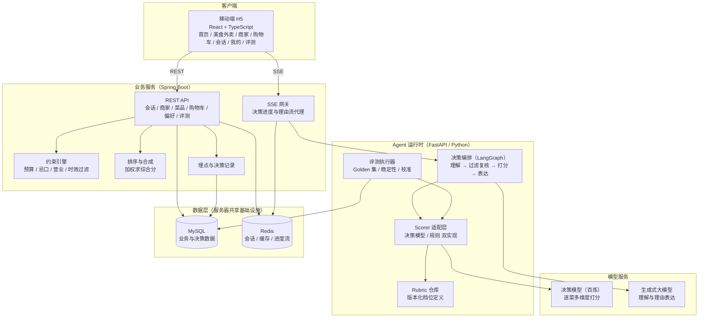
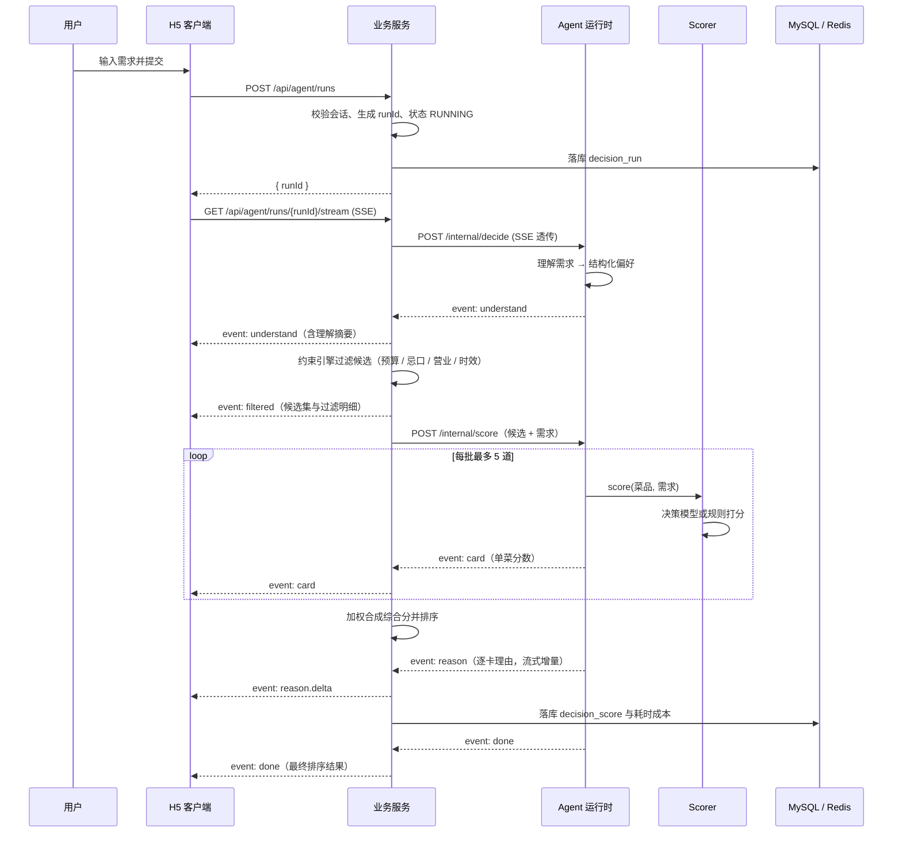
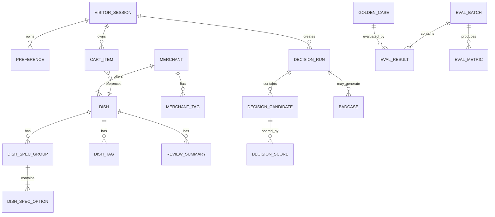
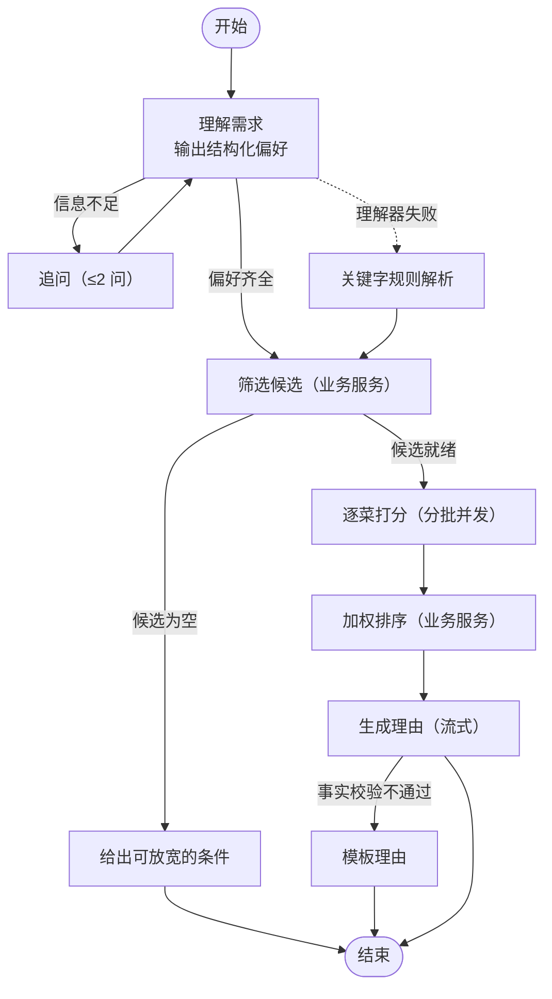
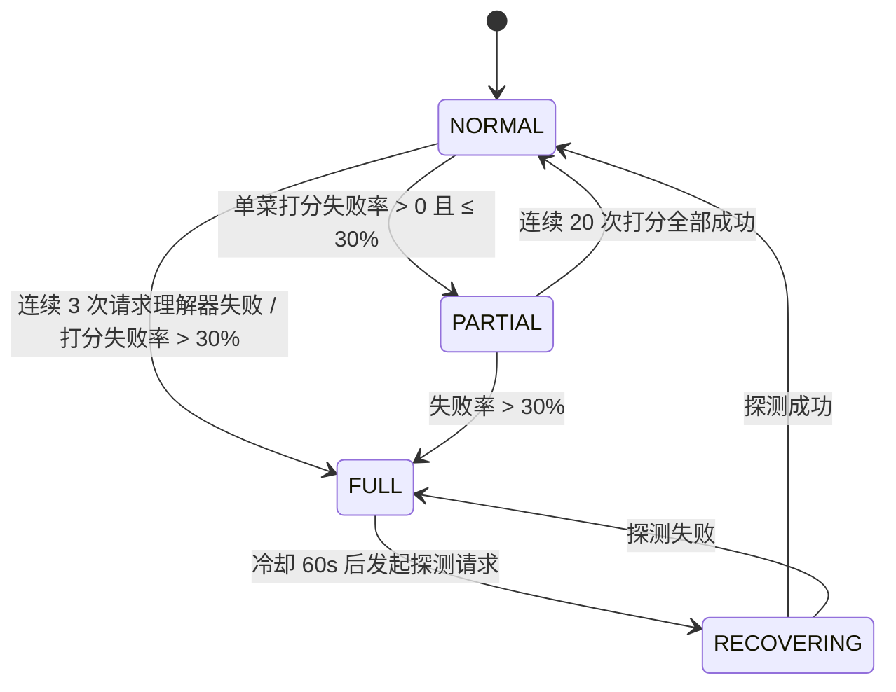
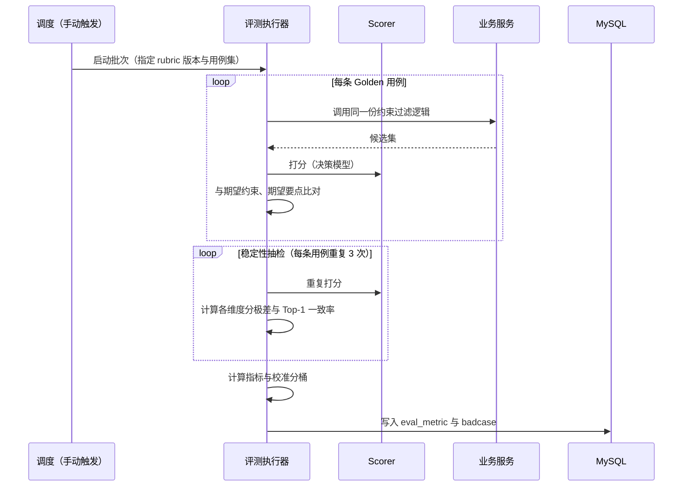
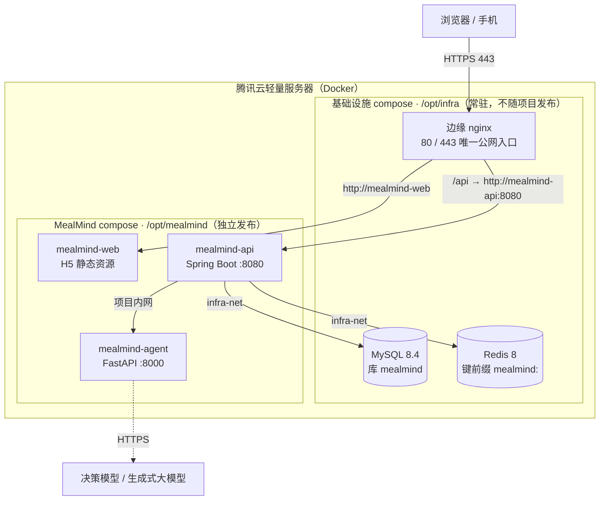

# MealMind 技术方案设计

2026-10-01 · v0.1 · 上游文档：[PRD.md](./PRD.md) · 原型：[prototype/index.html](../prototype/index.html) · 设计契约：[design-contract.md](./design-contract.md)

本文回答「怎么搭」，不重复 PRD 的「做什么」，也不写代码级实现。

## 1. 设计概览

### 1.1 目的与范围

覆盖 MealMind 演示版从移动端 H5 到模型调用的完整技术方案：三端分层架构、数据模型、接口契约、Agent 运行时的打分与降级实现、评测系统、部署方式。

不在本文范围：结算与支付、真实商家数据接入、账号体系与实名、生产级容量规划、视觉设计（见设计契约）。

### 1.2 需求追溯

| 设计目标                           | 上游需求                | 说明                       |
| ---------------------------------- | ----------------------- | -------------------------- |
| 一句需求 3 轮内给出 3–5 个带分候选 | PRD 1.2 产品目标 1      | 决策链路与结果卡片         |
| 硬约束零违规                       | PRD 1.2 产品目标 2、5.3 | 约束由业务服务执行         |
| 每个分数可解释                     | PRD 1.2 产品目标 3、5.4 | 维度分 + 档位说明 + 置信度 |
| 成本与延迟可量化                   | PRD 1.2 产品目标 4、5.8 | 决策记录落库 + 评测看板    |
| 链路可降级、断线可恢复             | PRD 5.7、4.7 异常边界   | 降级状态机 + 快照          |
| 主观打分可评测                     | PRD 7.1–7.4             | Golden 集 + 稳定性 + 校准  |

### 1.3 设计目标与约束

功能目标：支撑 PRD 第 4 章 23 项功能（演示期 P0/P1）。

非功能约束：

| 约束         | 指标                                                                                    | 来源                                      |
| ------------ | --------------------------------------------------------------------------------------- | ----------------------------------------- |
| 端到端延迟   | 提交需求到结果出完 P95 ≤ 3s                                                             | PRD 5.8 [Data-backed]                     |
| 打分环节延迟 | P95 ≤ 1s                                                                                | PRD 5.8 [Data-backed]                     |
| 单次决策成本 | ≤ ¥0.01                                                                                 | PRD 5.8 [Data-backed]                     |
| 硬约束违规   | 0（发布门禁）                                                                           | PRD 7.2 [Data-backed]                     |
| 演示规模     | 40 商家 / 约 600 菜品 / 单商圈                                                          | PRD 6.1 [Data-backed]                     |
| 部署形态     | 腾讯云轻量服务器单机 Docker；项目独立 compose 接入既有基础设施网络；GitHub Actions 发布 | PRD 8.1 / 实际环境（§8）[Expert judgment] |
| 投入约束     | 求职期个人开发，优先打通主路径                                                          | PRD 8.2 [Data-backed]                     |

### 1.4 术语

沿用 PRD 附录 C，新增：Scorer（打分器）、Decision Run（一次决策的执行记录）、Rubric（评分档位定义）、需求指纹（偏好归一化哈希）、降级档位（NORMAL / PARTIAL / FULL）。

## 2. 系统架构

### 2.1 架构风格与理由

选择「前端独立 + 业务服务与 Agent 运行时分离」的层状架构，而不是单体或纯 Python 服务。

理由：AI 编排与评测的生态在 Python（模型 SDK、评测脚本、数据处理都更顺手），业务事务与约束校验留在 Java（事务、校验、缓存这些能力成熟，且与本人已有项目经验一致，能复用）[Expert judgment]。两者分开还带来一个直接好处：Agent 运行时不可用时，浏览、加购、购物车全部照常，只有智能推荐降级——这正好满足 PRD 5.7 对降级的要求。

一个关键边界：Agent 运行时**不直接写业务数据**。它只接收业务服务给它的候选与原话，返回打分与文案；写入一律由业务服务完成。这样并发写冲突、权限越界、幂等这些问题都收敛在一个服务里 [Expert judgment]。

### 2.2 架构图



图读法：H5 只与业务服务通信（REST 拿数据、SSE 拿流），不直连 Agent 运行时。业务服务承担鉴权、约束、排序、落库；Agent 运行时只做语义工作（理解、打分、表达）。评测执行器复用同一个 Scorer 适配层，保证「评测用的打分逻辑」与「线上的打分逻辑」是同一份实现，这是评测结果可信的前提。

### 2.3 组件职责与边界

| 组件          | 负责                                                                                                 | 不负责                                           |
| ------------- | ---------------------------------------------------------------------------------------------------- | ------------------------------------------------ |
| H5 客户端     | 页面渲染、交互、本地登录态与会话快照兜底、埋点上报                                                   | 约束判断、分数合成、任何模型调用                 |
| 业务服务      | 游客会话、商家与菜品数据、购物车、偏好、硬约束过滤、加权排序、决策记录与埋点、SSE 转发、评测看板数据 | 语义理解、打分、文案生成                         |
| Agent 运行时  | 需求理解、追问判定、调用 Scorer 打分、理由生成与事实校验、评测任务执行                               | 业务数据写入、价格与时效计算、用户鉴权、最终排序 |
| Scorer 适配层 | 对同一份「菜品 + 需求」产出五维分与置信度，屏蔽决策模型与规则实现的差异                                 | 组织候选、决定权重、写库                         |
| 数据库        | 业务数据与决策记录的持久化                                                                           | —                                                |

依赖方向单向：H5 → 业务服务 → Agent 运行时 → 模型。无反向依赖，无环。

### 2.4 关键流程数据流

一次完整决策的时序（正常路径）：



要点：排序放在业务服务而不是 Agent 运行时，理由是排序依赖加权公式与候选集，属于确定性逻辑，放在有事务与缓存的一侧更好测、也更好在产品层调权重 [Expert judgment]。SSE 由业务服务转发而不是前端直连 Agent，是为了单一鉴权入口、便于埋点与审计、避免把内部运行时的地址暴露出去 [Expert judgment]。

### 2.5 技术选型与理由

| 选型                       | 理由                                                                                                                                                                                                                                     | 备注                                                                                         |
| -------------------------- | ---------------------------------------------------------------------------------------------------------------------------------------------------------------------------------------------------------------------------------------- | -------------------------------------------------------------------------------------------- |
| React + TypeScript + Vite  | 与原型技术选型一致，组件与状态管理生态成熟；H5 便于扫码演示                                                                                                                                                                              | [Expert judgment]                                                                            |
| TanStack Query + Zustand   | 服务端状态与交互状态分开，SSE 增量归并与快照兜底更清晰                                                                                                                                                                                   | [Expert judgment]                                                                            |
| Spring Boot + MyBatis-Plus | 事务、参数校验、缓存能力成熟，同一套写法已在既有项目中验证                                                                                                                                                                               | [Expert judgment]                                                                            |
| FastAPI + Python           | 模型 SDK 与评测生态在 Python，编排代码量最小                                                                                                                                                                                             | [Expert judgment]                                                                            |
| LangGraph（决策编排）      | 决策链路是有条件分支的有限状态机（追问、无候选、部分降级、重试），用状态图表达比手写分支清晰，节点边界又能与 SSE 事件一一对应；与既有两个项目同栈但用法不同：ForgeAI 是有界工具循环，HengPick 是链路编排，本项目是带降级分支的决策状态图 | [Expert judgment]                                                                            |
| MySQL                      | 决策记录需要事务与关系查询（评测统计按维度聚合）                                                                                                                                                                                         | [Expert judgment]                                                                            |
| Redis                      | 打分缓存（键为菜品 + 需求指纹 + rubric 版本）与进度流，读写量大且可丢                                                                                                                                                                    | [Expert judgment]                                                                            |
| 决策模型（TypeSafe System One） | 逐菜打分需要类型化输出与概率分布，且不生成文本，延迟与成本与输出长度无关；令牌上限 64k，量表建议 3–7 级           | [Research-backed] 2026-10；阿里云百炼 `decision-model-preview` 接入（限时免费，实测服务端 65–75ms）；原 Jev 经 TeamoRouter 接入，2026-10-12 下线后同协议平替 |
| 生成式大模型（理解与表达） | 语义理解与自然语言表达是它的强项，且不需要概率校准                                                                                                                                                                                       | [Expert judgment] **已定：阿里云百炼 qwen3.8**；理解器与表达器默认 flash，max 经配置切换         |
| Docker Compose             | 项目只用一个 compose 编排三个应用，以外部网络接入服务器既有基础设施（nginx / MySQL / Redis），复用而不重复部署；发布只动自己的容器，不触碰基础设施与其它项目                                                                             | 与既有项目部署方式一致 [Expert judgment]                                                     |
| GitHub Actions + GHCR      | push `main` 即测试、构建镜像、推送镜像仓库并部署到服务器；按变更路径只重建受影响的服务，演示期不需要更重的发布系统                                                                                                                       | [Expert judgment]                                                                            |

关于打分模型的已知弱项（原 Jev 官方文档明确列出算术、日期、干扰信息、中文弱于英文），本方案的处理方式是**用架构规避而不是靠提示词补救**：价格、预算占比、时效、月售等数值全部由业务服务算好，以文字摘要进入打分输入；rubric 档位描述用短句中文 [Expert judgment]。平替的 `decision-model-preview` 沿用同一输入形态与档位定义，规避策略不变。

## 3. 模块设计

### 3.1 业务服务

| 项   | 内容                                                                                     |
| ---- | ---------------------------------------------------------------------------------------- |
| 职责 | 提供会话、商家菜品、购物车、偏好、决策编排与记录的全部接口，并执行硬约束过滤与综合分排序 |
| 输入 | H5 的 REST 与 SSE 请求；Agent 运行时的打分与文案事件                                     |
| 输出 | JSON 响应、SSE 事件流、决策记录落库、埋点事件                                            |
| 依赖 | MySQL、Redis、Agent 运行时、生成式模型（间接）                                           |
| 边界 | 不做语义理解，不生成文案，不直接调用模型                                                 |

内部子模块：

- 会话模块：游客身份创建、登录态校验（长期有效，退出即失效）。
- 商品模块：商家、菜品、规格、评价摘要的查询与缓存。
- 购物车模块：条目增删改查，唯一性由「菜品 + 规格」决定。
- 约束引擎：按 PRD 5.3 的六条规则过滤候选，产出「已过滤 N 个，原因分布」的明细，供前端展示与评测统计。
- 排序合成：按 PRD 5.4 权重合成 0–100 综合分，分数接近（Δ≤2）时并列。
- 决策编排：创建 run、转发 SSE、聚合打分、落库、超时与降级兜底。
- 记录与埋点：决策记录与 PRD 6.3 的埋点事件写入。

### 3.2 Agent 运行时

| 项   | 内容                                                                                 |
| ---- | ------------------------------------------------------------------------------------ |
| 职责 | 把自然语言需求转成结构化偏好；对给定候选逐菜打分；生成受约束的推荐理由；执行评测任务 |
| 输入 | 待理解的原文；待打分的候选与需求；评测批次指令                                       |
| 输出 | 结构化偏好、逐菜五维分与置信度、逐卡理由、评测结果                                   |
| 依赖 | Scorer 适配层、决策模型、生成式大模型、Rubric 仓库                                  |
| 边界 | 不算价、不排序、不写业务库、不直接面向客户端                                         |

编排层用 LangGraph 的 StateGraph 搭建：每个节点只做一件事，节点之间的条件边承载追问回环、跳过与降级分支；图本身不保存运行状态，run 的快照由业务服务统一持久化（见 §6），避免两处状态口径不一致。

三个内部能力：

1. 理解器（Understander）：输出 PRD 5.2 定义的偏好结构，并给出 0–2 个待确认问题。模型失败时降级为关键字规则解析（词表匹配口味、数字提取预算、忌口词表）。
2. 打分器（Scorer 适配层）：对外统一为 `score(candidates, profile, rubric) -> CandidateScore[]`，内部两个实现见 §6.2。
3. 表达器（Phraser）：按 PRD 5.5 的约束生成理由，输出后做一次事实校验（数字与标签是否都出现在输入集合内），校验失败则改用模板拼接。

Rubric 仓库：档位定义以 YAML 文件维护，带版本号；运行时加载并缓存。改档位必须升版本号，因为缓存键和决策记录都引用它 [Expert judgment]。

### 3.3 评测执行器

作为 Agent 运行时的一个离线任务模块，不参与在线请求。职责：跑 Golden 集、计算稳定性与校准、产出快照与 badcase。复用线上同一份 Scorer，失败用例写入 badcase 表。

## 4. 接口设计

约定：所有接口以 `/api` 开头，鉴权用请求头 `X-Session-Id`（游客登录后下发）；统一响应体 `{ code, message, data }`，`code = 0` 表示成功；时间统一 ISO 8601；分页参数 `page`（从 1 起）与 `pageSize`（默认 10，上限 50）。

### 4.1 接口清单

| #   | 方法   | 路径                               | 用途                       | 鉴权 |
| --- | ------ | ---------------------------------- | -------------------------- | ---- |
| 1   | POST   | `/api/session/guest`               | 创建游客身份               | 无   |
| 2   | GET    | `/api/session/me`                  | 查询当前登录态             | 是   |
| 3   | DELETE | `/api/session`                     | 退出登录（清空该游客数据） | 是   |
| 4   | GET    | `/api/home/merchants`              | 首页推荐商家流             | 是   |
| 5   | GET    | `/api/foods/merchants`             | 美食外卖页商家列表         | 是   |
| 6   | GET    | `/api/merchants/{merchantId}`      | 商家详情                   | 是   |
| 7   | GET    | `/api/merchants/{merchantId}/menu` | 商家菜单（分类与菜品）     | 是   |
| 8   | GET    | `/api/cart`                        | 查询购物车                 | 是   |
| 9   | POST   | `/api/cart/items`                  | 加入购物车                 | 是   |
| 10  | PATCH  | `/api/cart/items`                  | 修改数量                   | 是   |
| 11  | DELETE | `/api/cart/items`                  | 删除条目 / 清空一组        | 是   |
| 12  | GET    | `/api/preferences`                 | 查询偏好记忆               | 是   |
| 13  | POST   | `/api/preferences`                 | 新增偏好                   | 是   |
| 14  | DELETE | `/api/preferences/{preferenceId}`  | 删除偏好                   | 是   |
| 15  | POST   | `/api/agent/runs`                  | 创建一次决策               | 是   |
| 16  | GET    | `/api/agent/runs/{runId}/stream`   | SSE 订阅决策进度           | 是   |
| 17  | GET    | `/api/agent/runs/{runId}`          | 拉取快照（断线恢复）       | 是   |
| 18  | POST   | `/api/agent/runs/{runId}/refine`   | 修正需求（换一批前端已下线，接口保留兼容） | 是   |
| 19  | GET    | `/api/eval/summary`                | 评测看板指标               | 是   |
| 20  | GET    | `/api/eval/badcases`               | badcase 列表               | 是   |
| 21  | GET    | `/api/search`                      | 关键字搜索（商家 / 菜品）  | 是   |
| 22  | GET    | `/api/eval/cost-summary`           | 单次决策成本摘要（看板）   | 是   |
| 23  | GET    | `/api/agent/runs`                  | 会话历史（重进水合消息流） | 是   |

内部接口（仅业务服务可调，走内网，用服务间令牌鉴权）：

| #   | 方法 | 路径                                  | 用途                                 |
| --- | ---- | ------------------------------------- | ------------------------------------ |
| I1  | POST | `/internal/decide`                    | 建立一次决策会话并返回 SSE 流        |
| I1b | POST | `/internal/decide/{runId}/candidates` | 回填约束过滤结果，恢复暂停中的决策图 |
| I1c | POST | `/internal/decide/{runId}/answers`    | 回填澄清回答，恢复暂停中的澄清节点   |
| I2  | POST | `/internal/score`                     | 对给定候选打分（可流式返回）         |
| I3  | POST | `/internal/phrase`                    | 生成推荐理由                         |

### 4.2 关键接口契约

**接口 1 · 创建游客身份**

| 字段      | 值                                                                             |
| --------- | ------------------------------------------------------------------------------ |
| Operation | `POST /api/session/guest`                                                      |
| Auth      | 无                                                                             |
| Request   | 无请求体                                                                       |
| Success   | `200`；`data: { sessionId, nickname, loginAt }`；`nickname` 形如 `干饭人_7F3A` |
| Error     | `500 SESSION_CREATE_FAILED`                                                    |
| 说明      | 登录态无过期时间；再次调用生成新身份并清除旧数据                               |

**接口 5 · 美食外卖页商家列表**

| 字段      | 值                                                                                                                                                                      |
| --------- | ----------------------------------------------------------------------------------------------------------------------------------------------------------------------- |
| Operation | `GET /api/foods/merchants`                                                                                                                                              |
| Auth      | `X-Session-Id`                                                                                                                                                          |
| Query     | `category`（可选，品类枚举，默认 `ALL`）、`sort`（`DEFAULT` / `DISTANCE` / `RATING`，默认 `DEFAULT`）、`page`、`pageSize`                                               |
| Success   | `200`；`data: { list: Merchant[], total, hasMore }`                                                                                                                     |
| Merchant  | `id, name, logoUrl, rating, monthlySales, deliveryMinutes, distanceMeters, minOrderAmount, deliveryFee, isOpen, rankLabel, promoTags[], featureTags[], previewDishes[]` |
| Error     | `401 UNAUTHORIZED`、`400 INVALID_CATEGORY`                                                                                                                              |

**接口 15 · 创建一次决策**

| 字段      | 值                                                                                                                                                                                |
| --------- | --------------------------------------------------------------------------------------------------------------------------------------------------------------------------------- |
| Operation | `POST /api/agent/runs`                                                                                                                                                            |
| Auth      | `X-Session-Id`                                                                                                                                                                    |
| Request   | `text`（string，1–200 字，必填）、`mode`（`GLOBAL` / `MERCHANT`，默认 `GLOBAL`）、`merchantId`（`mode = MERCHANT` 时必填）、`preferenceIds`（string[]，可选，本次会话启用的偏好） |
| Success   | `200`；`data: { runId, streamUrl }`                                                                                                                                               |
| Error     | `400 EMPTY_TEXT`、`400 TEXT_TOO_LONG`、`400 MERCHANT_ID_REQUIRED`、`404 MERCHANT_NOT_FOUND`、`429 TOO_MANY_RUNS`（同一会话并发 run 上限 3）                                       |
| 幂等      | 同一会话 5 秒内相同 `text` + `mode` 视为重复，直接返回已有 `runId`                                                                                                                |

并发上限与幂等窗口是为了防止用户连点造成重复计费，两者都是演示评审时会问到的点 [Expert judgment]。

**接口 16 · SSE 事件协议**

| 字段      | 值                                                                                    |
| --------- | ------------------------------------------------------------------------------------- |
| Operation | `GET /api/agent/runs/{runId}/stream`                                                  |
| Auth      | `X-Session-Id`                                                                        |
| 响应头    | `Content-Type: text/event-stream`、`Cache-Control: no-cache`、`X-Accel-Buffering: no` |
| 事件格式  | `event: <类型>` + `data: <JSON>`，每条含 `seq`（自增序号）与 `runId`                  |
| 心跳      | 每 15s 发送 `event: heartbeat`                                                        |
| 错误      | `404 RUN_NOT_FOUND`、`401 UNAUTHORIZED`                                               |

事件类型：

| event              | 触发时机                     | data 关键字段                                                                                                            |
| ------------------ | ---------------------------- | ------------------------------------------------------------------------------------------------------------------------ |
| `understand`       | 需求解析完成                 | `profile`（PRD 5.2 结构）、`questions[]`、`fromFallback`（是否规则降级）、`clarifyResolved`（二次理解，M4 W2）、`appliedPreferences[]`（本次带入的偏好，M4 W1） |
| `clarify`          | 信息不足需追问（M4 W2）      | `questions[]`（每题 `id` / `type` / `title` / `options[{id,label,value}]` / `skippable`）、`allowSkip`（恒 true）、`maxQuestions`（本轮问题数，最多 2） |
| `clarify.resolved` | 追问结束（回答 / 跳过 / 超时） | `skipped`、`reason`（`answered` / `user_skip` / `timeout`）                                                              |
| `filtered`         | 约束过滤完成                 | `candidateCount`、`filteredDetail`（各约束命中次数，对齐 PRD 5.3）                                                       |
| `scoring`          | 打分批次进度                 | `done`、`total`、`mode`（`DECISION` / `RULE` / `MIXED`）                                                                      |
| `card`             | 单菜打分完成                 | `card`（名称、商家、价格、综合分、五维分、置信度、模式标记）                                                             |
| `reason.delta`     | 理由流式增量                 | `dishId`、`text`                                                                                                         |
| `usage`            | 链路收尾的用量与阶段耗时（M4 W5） | `inputTokens`、`outputTokens`、`decisionCalls`、`estimated`、`understandMs`、`scoreMs`、`phraseMs`、`filterWaitMs`         |
| `done`             | 全部完成                     | `cards[]`（最终排序）、`latencyMs`、`costYuan`、`costBreakdown`（token 与决策模型调用数）、`rubricVersion`、`degradeLevel`  |
| `degraded`         | 触发降级                     | `level`（`PARTIAL` / `FULL`）、`reason`                                                                                  |
| `error`            | 无法完成                     | `code`、`message`、`retryable`                                                                                           |

`seq` 的作用是断线重连时按序号补发，前端只接受比本地更大的序号，避免重复渲染 [Expert judgment]。

**接口 17 · 快照（断线恢复）**

| 字段      | 值                                                                                                                                                                     |
| --------- | ---------------------------------------------------------------------------------------------------------------------------------------------------------------------- |
| Operation | `GET /api/agent/runs/{runId}`                                                                                                                                          |
| Success   | `200`；`data: { runId, status, profile, filteredDetail, cards[], lastSeq, latencyMs, costYuan, rubricVersion, degradeLevel, clarify, clarifyState }`；`status` ∈ `RUNNING` / `DONE` / `FAILED` / `DEGRADED` |
| 说明      | 前端重连先拉快照对齐，再带 `Last-Event-ID` 续订流；`clarify` 为待答澄清载荷（未追问为 null），`clarifyState` ∈ `PENDING` / `ANSWERED` / `SKIPPED`（M4 W2）。`RUNNING + PENDING` 表示正处于等待澄清：前端恢复追问卡并续订流，而非按「连接中断」处理 |

**接口 18 · 修正（换一批已下线）**

| 字段      | 值                                                                                                              |
| --------- | --------------------------------------------------------------------------------------------------------------- |
| Operation | `POST /api/agent/runs/{runId}/refine`                                                                           |
| Request   | `type`（`REFINE` / `NEXT_BATCH`）、`text`（`REFINE` 时必填）、`excludeDishIds`（`NEXT_BATCH` 时传已展示的菜品）、`pageSize`（`NEXT_BATCH` 可选，默认 5、上限 5） |
| Success   | `200`；`data: RefineResponse`——`REFINE` → `{ runId（新）, streamUrl, cards: null, hasMore: null }`；`NEXT_BATCH` → `{ runId（原）, streamUrl: null, cards[], hasMore }` |
| Error     | `404 RUN_NOT_FOUND`、`409 RUN_NOT_DONE`（父 run 未完成）、`400 EMPTY_TEXT` / `TEXT_TOO_LONG` / `INVALID_PARAM`、`429 TOO_MANY_RUNS` |
| 说明      | `REFINE` 新建继承 run（落 `parent_run_id`，继承原 run 的 mode / merchantId 与带入偏好；文本 = 原话 + 修正），走完整理解与 SSE，未受影响菜品的打分自然复用缓存；`NEXT_BATCH` 同 run 直接读已落库候选重建卡片（排除 `excludeDishIds`、按 `rank_no` 取下一组），零模型成本、无 SSE 秒回，`hasMore=false` 表示候选已看完。**`NEXT_BATCH` 自 2026-10-13 起前端已不再调用**（结果改为横向滑动浏览全部 ≤5 张候选，取消「换一批」按钮），接口与参数保留仅为向后兼容，无新功能依赖 |

**接口 23 · 会话历史（重进水合）**

| 字段           | 值                                                                                                                                                                                                                                          |
| -------------- | ------------------------------------------------------------------------------------------------------------------------------------------------------------------------------------------------------------------------------------------- |
| Operation      | `GET /api/agent/runs?limit=3`                                                                                                                                                                                                              |
| Auth           | `X-Session-Id`                                                                                                                                                                                                                              |
| Query          | `limit`（可选，默认 3、上限 20，取最近 N 轮；默认 3 轮兼顾上下文与首屏渲染负担）                                                                                                                                                            |
| Success        | `200`；`data: { items: RunHistoryItem[] }`，按 `created_at` 升序（旧 → 新）                                                                                                                                                                 |
| RunHistoryItem | `runId, inputText, mode, merchantId, status, degradeLevel, latencyMs, parentRunId, clarifyState, clarify, profile, filtered, appliedPreferences[], cards[]`；未产出阶段的字段为 null / 空列表，口径对齐接口 17                                                                                                    |
| 说明           | 前端进入会话页时调用，把最近轮次水合成消息流（含结果卡片与理由、五维分）；`status = RUNNING` 的轮次由前端续订 SSE（接口 16）接上进度，`clarifyState = PENDING` 的恢复追问卡可继续作答，`FAILED` 以错误块展示可重试。`filtered.poolSize` 未落库，由 `candidate_count` 与 `filtered_detail` 按约束计数口径回推（扣除被放宽的 `overBudget` 避免重复计数） |

**接口 I1c · 澄清回答回填（协作式编排的续接调用）**

| 字段      | 值                                                                                             |
| --------- | ---------------------------------------------------------------------------------------------- |
| Operation | `POST /internal/decide/{runId}/answers`                                                        |
| Auth      | 服务间令牌（请求头 `X-Internal-Token`）                                                        |
| Request   | `answers[{ questionId, optionId \| null }]`、`skipped`（整轮跳过）                              |
| Success   | `200`；`{ accepted: true }`                                                                    |
| Error     | `404` 未知或已结束的 run；`409` 该 run 当前不在澄清等待态                                      |
| 对外封装  | `POST /api/agent/runs/{runId}/answers`（入参相同）；错误码 `404 RUN_NOT_FOUND`、`409 CLARIFY_NOT_PENDING` |

决策图在澄清节点暂停等待该调用（最多 2 问、每 run 一轮，60s 无回答按超时收口）。业务服务收到 `clarify` 后落库 `clarify_json` / `clarify_state=PENDING` 并转发，用户提交后回填；回答合并只补缺失字段（口味取并集、预算仅在为空时写入），随后二次 `understand`（`clarifyResolved: true`）继续过滤打分；跳过 / 超时则 `profile` 不变，发 `clarify.resolved` 后正常出结果。外观与 I1b 相同：调用仍由业务服务发起，Agent 不反向访问业务数据。

**接口 I2 · 内部打分**

| 字段           | 值                                                                                                                                                            |
| -------------- | ------------------------------------------------------------------------------------------------------------------------------------------------------------- |
| Operation      | `POST /internal/score`                                                                                                                                        |
| Auth           | 服务间令牌（请求头 `X-Internal-Token`）                                                                                                                       |
| Request        | `profile`（结构化偏好）、`candidates[]`（每项含 `dishId`、名称、描述、标签、以及业务服务算好的文字摘要：价格、时效、口碑）、`rubricVersion`、`stream`（bool） |
| Success        | `stream=false` 时返回 `{ scores: CandidateScore[] }`；`stream=true` 时按 `card` 事件流式返回                                                                  |
| CandidateScore | `dishId, dims{ taste, budget, timeliness, reputation, scene }`（各含 `value` 0–10、`confidence` 0–1、`distribution`）、`conflictGuard`（0–1）、`mode`         |
| Error          | `400 RUBRIC_VERSION_UNKNOWN`、`502 MODEL_UNAVAILABLE`、`504 MODEL_TIMEOUT`                                                                                    |

打分接口要求调用方传入 rubric 版本，是为了让缓存与评测可追溯——同一份输入在不同 rubric 下结果不可混用 [Expert judgment]。

**接口 I1b · 候选回填（协作式编排的续接调用）**

| 字段      | 值                                                                                             |
| --------- | ---------------------------------------------------------------------------------------------- |
| Operation | `POST /internal/decide/{runId}/candidates`                                                     |
| Auth      | 服务间令牌（请求头 `X-Internal-Token`）                                                        |
| Request   | `candidates[]`（约束过滤后的候选：`dishId`、名称、价格、标签、商家评分、配送时长、月售等事实） |
| Success   | `200`；`{ accepted }`                                                                          |
| Error     | `404` 未知或已结束的 run                                                                       |

决策图执行到「筛选候选」节点时暂停等待该调用；业务服务收到 `understand` 事件后执行约束引擎，把候选数组回填，图从该点继续打分与表达。依赖方向保持单向：调用仍由业务服务发起，Agent 不反向访问业务数据 [Expert judgment]。

## 5. 数据设计

### 5.1 ER 图



### 5.2 核心表

表结构按业务视角给出关键字段，完整 DDL 在实现阶段补充。

M4 增量列（`preference.seen_count` / `last_seen_run_id`、`decision_run.applied_preference_ids` / `parent_run_id` / `clarify_json` / `clarify_state`、`decision_candidate.reason`）由 `deploy/sql/11_m4_alter.sql` 幂等追加（`information_schema.columns` 判断的动态 SQL，可重复执行）：`10_schema.sql` 全是 `CREATE TABLE IF NOT EXISTS`，对既有库不会追加新列，M4 变更必须走独立 alter 脚本。

**visitor_session（游客会话）**

| 字段           | 类型        | 约束     | 说明                 |
| -------------- | ----------- | -------- | -------------------- |
| id             | varchar(32) | PK       | 会话标识             |
| nickname       | varchar(32) | NOT NULL | 自动昵称             |
| created_at     | datetime    | NOT NULL | 创建时间             |
| last_active_at | datetime    | NOT NULL | 最后活跃时间         |
| status         | varchar(16) | NOT NULL | `ACTIVE` / `REVOKED` |

退出登录（接口 3）置 `REVOKED`，并级联删除该会话的购物车条目、偏好与决策记录（先删 `decision_candidate` / `decision_score`，再删 `decision_run`），对齐 PRD「会话记录随退出清除」。

**dish（菜品）**

| 字段          | 类型          | 约束         | 说明                                        |
| ------------- | ------------- | ------------ | ------------------------------------------- |
| id            | varchar(32)   | PK           | 菜品标识，形如 `m1-2-1`（商家-分类序-菜序） |
| merchant_id   | varchar(32)   | FK, NOT NULL | 所属商家                                    |
| category_id   | varchar(32)   | NOT NULL     | 菜单分类                                    |
| name          | varchar(64)   | NOT NULL     | 名称                                        |
| description   | varchar(200)  | NULL         | 描述                                        |
| price         | decimal(10,2) | NOT NULL     | 现价                                        |
| origin_price  | decimal(10,2) | NULL         | 原价                                        |
| monthly_sales | int           | NOT NULL     | 月售                                        |
| is_available  | tinyint       | NOT NULL     | 可售状态（售罄置 0）                        |
| is_combo      | tinyint       | NOT NULL     | 是否套餐                                    |

**decision_run（决策记录）** —— 评测与看板的主数据源

| 字段                | 类型         | 约束         | 说明                                       |
| ------------------- | ------------ | ------------ | ------------------------------------------ |
| id                  | varchar(32)  | PK           | runId                                      |
| session_id          | varchar(32)  | FK, NOT NULL | 所属会话                                   |
| input_text          | varchar(200) | NOT NULL     | 用户原话                                   |
| profile_json        | json         | NOT NULL     | 结构化偏好                                 |
| profile_fingerprint | char(32)     | NOT NULL     | 偏好归一化哈希，打分缓存键的一部分         |
| mode                | varchar(16)  | NOT NULL     | `GLOBAL` / `MERCHANT`                      |
| merchant_id         | varchar(32)  | NULL         | 本店模式下的商家                           |
| status              | varchar(16)  | NOT NULL     | `RUNNING` / `DONE` / `FAILED` / `DEGRADED` |
| degrade_level       | varchar(16)  | NOT NULL     | `NORMAL` / `PARTIAL` / `FULL`              |
| rubric_version      | varchar(16)  | NOT NULL     | 打分档位版本                               |
| candidate_count     | int          | NOT NULL     | 过滤后候选数                               |
| filtered_detail     | json         | NULL         | 各约束命中次数                             |
| latency_ms          | int          | NULL         | 端到端耗时                                 |
| cost_yuan           | decimal(8,5) | NULL         | 模型调用成本（M4 W5 起为标价口径实算）     |
| parent_run_id       | varchar(32)  | NULL         | `REFINE` 继承来源 run（接口 18）           |
| applied_preference_ids | json      | NULL         | 本次带入的偏好 id（快照恢复与 `REFINE` 继承基线） |
| clarify_json        | json         | NULL         | 待答澄清问题载荷（快照恢复追问卡）         |
| clarify_state       | varchar(16)  | NULL         | `PENDING` / `ANSWERED` / `SKIPPED`         |
| created_at          | datetime     | NOT NULL     | 创建时间                                   |

**decision_score（逐菜各维度分）**

| 字段         | 类型         | 约束         | 说明                                                       |
| ------------ | ------------ | ------------ | ---------------------------------------------------------- |
| id           | bigint       | PK, AUTO     | 主键                                                       |
| run_id       | varchar(32)  | FK, NOT NULL | 所属 run                                                   |
| dish_id      | varchar(32)  | NOT NULL     | 菜品                                                       |
| dim          | varchar(16)  | NOT NULL     | `taste` / `budget` / `timeliness` / `reputation` / `scene` |
| value        | decimal(4,2) | NOT NULL     | 0–10                                                       |
| confidence   | decimal(4,3) | NOT NULL     | 0–1                                                        |
| distribution | json         | NULL         | 档位概率分布                                               |
| score_mode   | varchar(8)   | NOT NULL     | `DECISION` / `RULE`                                        |

每菜共 5 行（一个维度一行），综合分不在此表，见 `decision_candidate`。

**decision_candidate（单次决策的候选与综合分）**

| 字段                 | 类型         | 说明                       |
| -------------------- | ------------ | -------------------------- |
| run_id + dish_id     | 联合唯一     | —                          |
| composite_score      | decimal(5,2) | 0–100                      |
| composite_confidence | decimal(4,3) | 加权置信度                 |
| rank_no              | int          | 最终名次（由代码排序写入） |
| is_shown             | tinyint      | 是否展示给用户             |
| is_added_to_cart     | tinyint      | 是否被加购（采纳指标来源） |
| reason               | varchar(64)  | 推荐理由（≤30 字；落库供快照恢复，M4 W1/W3；原用于换一批重建卡片，换一批前端已下线后仅快照恢复使用） |

**其余实体**

| 表               | 关键字段                                                                                                                                    | 说明                                                                       |
| ---------------- | ------------------------------------------------------------------------------------------------------------------------------------------- | -------------------------------------------------------------------------- |
| merchant         | `id, name, logo_url, rating, monthly_sales, delivery_minutes, distance_meters, min_order_amount, delivery_fee, is_open, notice, rank_label` | 商家；`is_open` 供营业状态约束使用                                         |
| merchant_tag     | `merchant_id, tag, tag_type`                                                                                                                | 商家标签，`tag_type` 区分营销标签与特色标签                                |
| preference       | `id, session_id, type, content, source, status, seen_count, last_seen_run_id`                                                                                             | 偏好记忆；`type` ∈ 口味 / 预算 / 忌口 / 场景；偏好仅由「我的」页手动写入（`source` 恒为 `MANUAL`，`status` ∈ `ACTIVE` / `IGNORED` 墓碑软删）。`seen_count` / `last_seen_run_id` 为 M4 W1 自动沉淀遗留列，自动沉淀已下线，字段保留不再写入 |
| cart_item        | `id, session_id, dish_id, spec_text, spec_hash, quantity, unit_price`                                                                       | 购物车条目；`spec_hash` 用于「菜品 + 规格」唯一性判定                      |
| dish_tag         | `dish_id, tag, tag_type`                                                                                                                    | 菜品标签，承载辣度、口味、食材、健康等维度，是约束与打分的主要输入         |
| dish_spec_group  | `id, dish_id, group_name, is_required, sort_no`                                                                                             | 规格分组（份量、加料）                                                     |
| dish_spec_option | `id, group_id, option_name, extra_price, is_default, sort_no`                                                                               | 规格选项与加价                                                             |
| review_summary   | `id, dish_id, merchant_id, summary_text, source`                                                                                            | 评价摘要，`source` 标注为模拟数据                                          |
| eval_batch       | `id, rubric_version, case_count, triggered_by, started_at, finished_at, status`                                                             | 评测批次                                                                   |
| eval_result      | `id, batch_id, case_id, passed, fail_detail_json`                                                                                           | 单条用例结果                                                               |
| tracking_event   | `id, session_id, event_name, props_json, occurred_at`                                                                                       | 埋点事件，对齐 PRD 6.3                                                     |

**golden_case（评测用例）**

| 字段                 | 类型         | 说明                                 |
| -------------------- | ------------ | ------------------------------------ |
| id                   | varchar(32)  | 主键                                 |
| case_type            | varchar(16)  | `STANDARD` / `BOUNDARY` / `NEGATIVE` |
| input_text           | varchar(200) | 需求原文                             |
| expected_constraints | json         | 必须满足 / 必须不出现的约束          |
| expected_points      | json         | 期望结果要点                         |
| rubric_version       | varchar(16)  | 绑定的档位版本                       |
| annotated_by         | varchar(32)  | 标注人                               |

**eval_metric（评测快照指标）**

| 字段         | 类型          | 说明                                                                                                                       |
| ------------ | ------------- | -------------------------------------------------------------------------------------------------------------------------- |
| batch_id     | varchar(32)   | 所属批次                                                                                                                   |
| metric_key   | varchar(32)   | `GOLDEN_PASS_RATE`、`TOP3_HIT_RATE`、`STABILITY`、`CALIBRATION_GAP`、`P95_E2E`、`P95_SCORING`、`AVG_COST`、`DEGRADE_COUNT` |
| metric_value | decimal(10,4) | 值                                                                                                                         |
| sample_size  | int           | 样本量（样本不足时不解读）                                                                                                 |
| computed_at  | datetime      | 计算时间                                                                                                                   |

**badcase**

| 字段        | 类型        | 说明                                  |
| ----------- | ----------- | ------------------------------------- |
| id          | bigint      | 主键                                  |
| run_id      | varchar(32) | 来源决策（线上 badcase 可空）         |
| case_id     | varchar(32) | 来源用例（评测 badcase 可空）         |
| category    | varchar(32) | 归因分类：数据 / 约束 / rubric / 模型 |
| detail_json | json        | 脱敏输入与打分明细                    |
| status      | varchar(16) | `OPEN` / `OBSERVING` / `FIXED`        |
| created_at  | datetime    | 记录时间                              |

### 5.3 索引与缓存

| 对象               | 索引 / 键                                                                | 理由                             |
| ------------------ | ------------------------------------------------------------------------ | -------------------------------- |
| decision_run       | `idx_session_created (session_id, created_at)`                           | 按会话查最近结果（断线恢复）与会话历史（接口 23 取最近 N 轮） |
| decision_candidate | `idx_run_rank (run_id, rank_no)`                                         | 结果页按名次取                   |
| decision_score     | `idx_run_dish (run_id, dish_id)`                                         | 评测按维度聚合                   |
| dish               | `idx_merchant_cat (merchant_id, category_id)`                            | 菜单页与候选筛选                 |
| eval_metric        | `idx_batch_key (batch_id, metric_key)`                                   | 看板读取                         |
| Redis 打分缓存     | `mealmind:score:{rubricVersion}:{profileFingerprint}:{dishId}`，TTL 600s | 修正类请求复用未受影响菜品的分数 |
| Redis 进度流       | `mealmind:run:{runId}:events`（List，按 seq），TTL 1800s                 | SSE 断线按 seq 补发              |

打分缓存把 rubric 版本与需求指纹都放进键里，是为了保证「改了档位定义」或「用户改了需求」时不会命中过期分数 [Expert judgment]。

一致性规则：决策记录与候选人选在同一个事务内写入；Redis 只作加速，丢失不影响正确性（缓存未命中就重新打分）。Redis 是服务器上的共享实例，本项目所有键统一带 `mealmind:` 前缀；缓存读写都在业务服务完成（cache-aside），Agent 不接任何存储（§8.1）。

## 6. Agent 运行时详细设计

编排图（LangGraph StateGraph）：



读取方式：实线是正常路径，虚线是降级路径。追问形成一次回环，由「最多 2 问」的计数器约束，不会无限循环；打分节点内部按菜品粒度重试，单菜失败不影响整批（§6.2）。每个节点都有明确失败出口：理解失败走规则解析、打分失败转规则分、理由失败转模板。LangGraph 的 checkpointer 在本项目关闭——一次决策是有界执行，run 状态由业务服务写入 MySQL 并同步 Redis 进度流（§5.3），让断线恢复的 seq 口径只有一个来源。

图的执行是协作式的：业务服务经 I1 建立 SSE 流后，图在「筛选候选」节点暂停，业务服务执行约束引擎并通过 I1b 回填候选，图从该点继续；图中标注「业务服务」的加权排序同样由业务服务在收流过程中完成。事件只有一个出口：Agent 产出 `understand` / `clarify` / `clarify.resolved` / `scoring` / `card` / `reason.delta` / `usage`，业务服务在转发前后补上 `filtered`（掌握过滤明细）、`done`（掌握加权公式、并列判定与落库口径）与 `error` / `degraded`，`seq` 由业务服务统一编号。这样「模型负责语义、代码负责确定性与账本」的边界落实在事件层，而不是停留在分工描述上 [Expert judgment]。

### 6.1 降级状态机



三档行为：

| 档位    | 打分实现                     | 用户可见                       | 记录                                  |
| ------- | ---------------------------- | ------------------------------ | ------------------------------------- |
| NORMAL  | 全部走决策模型               | 无差异                         | `score_mode = DECISION`               |
| PARTIAL | 失败菜品走规则分，其余走决策模型 | 该卡标注「规则分」             | `degrade_level = PARTIAL`，卡片级标记 |
| FULL    | 全部走规则分                 | 顶部横幅「当前为规则推荐模式」 | `degrade_level = FULL`                |

冷却与探测阈值取 60 秒与单次探测，是为了避免模型恢复瞬间被并发请求打回降级 [Expert judgment]。

### 6.2 Scorer 双通道

统一接口（Python 协议，示意）：

```
class Scorer(Protocol):
    def score(self, candidates: list[Candidate], profile: Profile, rubric: Rubric) -> list[CandidateScore]
```

两个实现：

| 实现         | 输入                                 | 输出                                     | 触发条件                           |
| ------------ | ------------------------------------ | ---------------------------------------- | ---------------------------------- |
| `DecisionScorer` | 业务服务算好的文字摘要 + rubric 档位 | 五维概率加权位置与置信度、忌口护栏概率   | 默认（`AUTO`）                     |
| `RuleScorer` | 标签匹配 + 价格公式 + 口碑分         | 同结构，置信度按固定规则给出（通常较低） | 决策模型不可用、超时、失败，或配置强制 |

`DecisionScorer` 的关键实现点（对应 PRD 5.4）：

- 一次请求内并行提交 5 个 `score` 问题与 1 个 `noul` 护栏问题，用决策模型的多问题并行能力省往返。
- 每个维度在请求中显式声明档位描述（2–10 级），返回后按档位归一化到 0–10。
- 单菜超时 3s、失败重试 1 次；候选按每批 5 道并发，候选上限 5 道即最多 1 批。
- 忌口护栏返回 ≥0.5 视为风险，剔除该菜并写 badcase。
- 调用预算：单次 run 的模型调用次数与总时长上限在配置中给出，超限即转 FULL 降级 [Expert judgment]。

`RuleScorer` 的规则集（用于降级与对照）：

| 维度       | 规则                                               |
| ---------- | -------------------------------------------------- |
| 口味贴合   | 需求口味标签与菜品标签的重合度映射到 0–10          |
| 预算吸引力 | 价格 / 预算上限的比例分段映射，越接近上限分越低    |
| 时效满足   | 期望送达上限与商家配送时长的差值分段映射           |
| 口碑支撑   | 商家评分与菜品月售归一化后加权                     |
| 场景适配   | 场景关键词与菜品标签的匹配（如「减脂」对「低卡」） |
| 忌口护栏   | 标签精确匹配，命中即判风险                         |

注意 `RuleScorer` 不是「假数据」，它是可在评测里与决策模型对比的真实基线——这也是回答「为什么不用规则」这个必然会被问到的问题的证据来源 [Expert judgment]。

### 6.3 缓存与去重

打分缓存由业务服务做 cache-aside（调打分接口前查、拿回结果后写），Agent 容器因此不接 Redis，只通过项目内网被调用（§8.1）。

- 缓存键：`mealmind:score:{rubricVersion}:{profileFingerprint}:{dishId}`，TTL 10 分钟。命中直接复用并标注，不重复计费。
- 条目内容 = 维度分 + 打分通道 + 推荐理由。理由同属模型产物，只缓存分数起不到「不重复计费」的作用。
- 命中的菜品不进回填的候选集，Agent 因此完全不参与打分与理由生成（图直接结束）；进度事件由业务服务把命中数补齐，前端看到的 `total` 始终是全部候选。缓存不可用时全部按未命中处理，不影响正确性。
- 需求指纹：把结构化偏好归一化（口味排序、预算取整、忌口排序）后哈希，保证「微辣 30 元内」与「30 元内 微辣」命中同一缓存。
- 换一批不重复打分：`NEXT_BATCH` 只从已有候选里取下一组，命中缓存。**注：`NEXT_BATCH` 自 2026-10-13 起前端已不再调用**（结果横向滑动浏览全部 ≤5 张候选），此缓存策略仅保留兼容。

### 6.4 超时与重试

| 环节     | 超时          | 重试 | 失败后                         |
| -------- | ------------- | ---- | ------------------------------ |
| 理解器   | 3s            | 1 次 | 降级为关键字解析               |
| 单菜打分 | 3s            | 1 次 | 该菜走规则分                   |
| 单批打分 | 4s            | 0    | 该批走规则分                   |
| 表达器   | 4s（整批）    | 1 次 | 模板理由                       |
| 整轮决策 | 12s           | 0    | 返回已得结果 + `degraded` 事件 |

参数依据（2026-10-10 实测）：

- **理解器**：qwen3.8-flash 默认「思考模式」下单次 2.9–7.7s，2s 超时会导致每次调用都超时回落；关闭思考（`enable_thinking=false`）后降至 0.9–2.0s（中位 1.26s），故取 3s（约 1.5× 实测上限）。
- **单菜打分**：原 Jev 经 TeamoRouter 实测中位 1.2s、上限 2.1s（12 次串行），原定 1.5s 约一半调用会超时，故取 3s；平替的 `decision-model-preview` 实测服务端仅 65–75ms（含 TLS 全链路约 0.3s/次，2026-10-12），3s 继续留足余量。
- **表达器**：单条调用 1.3s 且候选串行需 26s（原 20 道上限），改为按批（每批 5 道）并发调用；候选上限 5 道即 1 批，多批场景同样并发而非串行。
- 实测整链路：10 道候选（Jev 打分 + qwen 理解/表达）端到端 5.2s，5 并发打分墙钟 1.06s；2026-10-12 平替复测（`decision-model-preview` + qwen 理解/表达，本地 compose）：20 道候选端到端 4.0s，打分阶段墙钟 1.1s，run 记 DONE / NORMAL。2026-10-13 候选上限由 20 收紧为 5 后：5 道候选端到端 2.5–4.5s，打分阶段墙钟 ≈0.3s，run 记 DONE / NORMAL。

## 7. 评测系统设计

### 7.1 执行流程



评测复用业务服务的约束过滤逻辑与线上同一份 Scorer，避免「评测环境的实现和线上不一样」这种常见失真 [Expert judgment]。

### 7.2 指标口径

| 指标          | 计算方式                                                 | 样本要求             |
| ------------- | -------------------------------------------------------- | -------------------- |
| Golden 通过率 | 全部期望约束与要点均满足的用例数 / 总用例数              | 全量用例             |
| Top-3 命中率  | 人工标注的相关菜品进入前 3 的比例                        | 需人工标注           |
| 打分稳定性    | 各维度分极差 ≤ 0.5 档的重复样本占比；Top-1 一致率        | 每条用例重复 3 次    |
| 校准偏差      | 各置信度分桶「实际采纳率」与「桶中心置信度」差值的绝对值 | 每桶样本 ≥ 30 才解读 |
| P95 延迟      | 决策记录中 `latency_ms` 与打分阶段耗时的 95 分位         | ≥ 100 次决策         |
| 单次成本      | `cost_yuan` 均值                                         | ≥ 100 次决策         |
| 降级次数      | `degrade_level != NORMAL` 的 run 数                      | 与总 run 数同口径    |

采纳率（线下评测用）在演示期用「人工标注为合理」替代线上加购数据，样本不足 30 的桶不解读并在看板标注——这条规则写进 PRD 7.3，实现上由 `sample_size` 字段驱动。

### 7.3 badcase 闭环

四个归因分类与处理：

| 分类   | 判定方式                    | 处理                               |
| ------ | --------------------------- | ---------------------------------- |
| 数据   | 菜品标签或评价摘要缺失/错误 | 修种子数据，重新生成               |
| 约束   | 硬约束被破坏                | 视为发布阻断项，优先修             |
| Rubric | 档位描述无法区分候选        | 改档位并升版本号                   |
| 模型   | 分数与人工判断明显不符      | 补进 Golden 集，评估提示与档位措辞 |

## 8. 部署与非功能设计

### 8.1 部署拓扑

服务器是腾讯云轻量服务器（Docker 镜像），全部容器化。服务器上已有一套常驻的**基础设施 compose**（`/opt/infra`：边缘 nginx + MySQL 8.4 + Redis 8 + Qdrant），为所有项目提供公共底座，本项目不部署、不重启、不升级它。MealMind 只维护自己的**项目 compose**（`/opt/mealmind`），两者通过共享的 `infra-net` 网络互通——网络名、服务访问方式与发布方式均沿用既有基础设施的约定。



图读法：公网只有边缘 nginx 一个入口，MealMind 不映射任何宿主机端口。三个容器的网络接入面不同，这是本拓扑的核心：

| 容器             | 接入网络                       | 说明                                                     |
| ---------------- | ------------------------------ | -------------------------------------------------------- |
| `mealmind-web`   | `infra-net`                    | 静态资源容器（nginx:alpine），只被边缘 nginx 反代        |
| `mealmind-api`   | `infra-net` + 项目内网         | 连共享 MySQL / Redis，对内调 Agent，对外提供 REST 与 SSE |
| `mealmind-agent` | 仅项目内网（`internal: true`） | 不接任何存储、不暴露端口；模型密钥只存在于该容器环境变量 |

网关归属：边缘 nginx 已是服务器唯一公网入口，本项目不再自建对外网关，也不需要新增防火墙规则（沿用 22 / 80 / 443）。Agent 的封闭性由网络直接保证——它无法访问数据库，也不在边缘路由的目标里 [Expert judgment]。

### 8.2 接入约定与首次部署

**网络与命名**：`infra-net` 由基础设施一次性创建，项目 compose 以 `external: true` 加入。服务名统一带项目前缀（`mealmind-*`）：一是避免与共享网络上其它项目的同名服务（`web`、`api`）冲突，二是边缘 nginx 可直接用 `http://mealmind-web`、`http://mealmind-api:8080` 反代，不需要额外声明网络别名。

**项目 compose 骨架**（`deploy/compose.yml`，只编排三个应用，不含任何存储）：

```yaml
name: mealmind
services:
  mealmind-web:
    image: ghcr.io/<owner>/mealmind-web:${MEALMIND_IMAGE_TAG:-latest}
    networks: [infra-net]
  mealmind-api:
    image: ghcr.io/<owner>/mealmind-api:${MEALMIND_IMAGE_TAG:-latest}
    environment:
      MYSQL_URL: jdbc:mysql://mysql:3306/mealmind
      REDIS_URL: redis://:${REDIS_PASSWORD}@redis:6379/0
      AGENT_BASE_URL: http://mealmind-agent:8000
      INTERNAL_TOKEN: ${MEALMIND_INTERNAL_TOKEN}
    networks: [infra-net, internal]
    depends_on:
      mealmind-agent: { condition: service_healthy }
  mealmind-agent:
    image: ghcr.io/<owner>/mealmind-agent:${MEALMIND_IMAGE_TAG:-latest}
    environment:
      # 模型密钥、内部令牌由 deploy/.env 注入，不提交仓库
      INTERNAL_TOKEN: ${MEALMIND_INTERNAL_TOKEN}
    networks: [internal]
networks:
  infra-net: { external: true }
  internal: { internal: true }
```

骨架之外的实现约定：三个服务统一 `restart: unless-stopped`、日志轮转（单文件 10MB × 3，对齐基础设施配置，避免写满磁盘）、健康检查（web 探 `/index.html`、api 探 `/actuator/health/readiness`、agent 探 `/healthz`），发布用 `up -d --wait` 以健康检查作为门禁。

**边缘路由**（infra 侧资产，在 `/opt/infra/nginx/conf.d/` 新增文件，随基础设施维护）：

| 路径                             | 转发目标                   | 要点                                                                |
| -------------------------------- | -------------------------- | ------------------------------------------------------------------- |
| `/`                              | `http://mealmind-web`      | 静态资源；带哈希资源长缓存、入口 HTML 不缓存；SPA 回退在 web 容器内 |
| `/api/agent/runs/{runId}/stream` | `http://mealmind-api:8080` | SSE 必须关缓冲（`proxy_buffering off`）并放宽 `proxy_read_timeout`  |
| `/api/`                          | `http://mealmind-api:8080` | 其余接口；前端同源访问，无 CORS 配置                                |

**数据接入**：在共享 MySQL 上为项目建独立库 `mealmind` 与独立账号（不复用 root，符合基础设施约定）；建表与种子脚本（固定随机种子）放 `deploy/sql/`，首次部署时导入，后续数据变更沿用同目录脚本。共享 Redis 不做初始化，靠 `mealmind:` 键前缀与其它项目隔离（§5.3）。

导入 SQL 必须显式指定字符集 `--default-character-set=utf8mb4`（如 `mysql --default-character-set=utf8mb4 ... < deploy/sql/30_golden_cases.sql`）：不带该参数时中文会被双重编码写入，表现为评测期望值比对永远不等、`understanding_accuracy` 恒为 0。排查以 `HEX()` 为准，不要看终端回显（不带字符集查询会把正确数据也显示成乱码）。

**服务器侧一次性操作**（首次部署）：

1. 建目录 `/opt/mealmind`（属主 `deploy`，CI 用 rsync 写入）；
2. 从 `deploy/.env.example` 生成 `deploy/.env`（MySQL 库账号密码、Redis 密码、内部令牌、模型密钥，不提交仓库）；
3. DNS 增加 A 记录（`mealmind.yjxai.cloud` → 服务器 IP）；按基础设施既有的 certbot webroot 流程签发证书（先落 80 端口 ACME 校验块，签发后启用 443 块，为该域名单独签发、不重签主站证书）；
4. 启动并用健康检查验证：`docker compose --env-file deploy/.env -f deploy/compose.yml up -d --wait`。

对外域名定为 `mealmind.yjxai.cloud`：子域名避开既有项目占用的 `/api`、`/lab` 子路径，SPA 基准路径与 SSE 按根路径处理最省事；边缘路由与证书均按该域名配置（只签此一个主机名，不需要 `www`）。

### 8.3 发布流水线（GitHub Actions）

沿用既有项目的发布方式：**CI 构建镜像 → 推送 GHCR → 服务器 SSH 拉取重启**，服务器上不构建源码。push `main` 触发，也支持手动指定服务；按变更路径只重建受影响的服务。仓库目标布局：`apps/h5`（H5）、`services/biz`（业务服务）、`services/agent`（Agent 运行时）、`deploy/`（部署资产）、`docs/` 与 `prototype/`（文档与原型，不参与构建）。

| 变更路径            | 重建与重启                 |
| ------------------- | -------------------------- |
| `apps/h5/**`        | mealmind-web               |
| `services/biz/**`   | mealmind-api               |
| `services/agent/**` | mealmind-agent             |
| `deploy/**`         | 只同步 compose，不重建镜像 |

单服务 job 的步骤：跑该侧检查（按各侧现状：H5 `npm ci && npm run lint && npm run build`；biz `mvn -B package`（暂无单测）；agent `python -m compileall app`（暂无 pytest））→ 构建镜像 → 推送 `ghcr.io/<owner>/mealmind-<服务>` 的 `<sha>` 与 `latest` 双 tag（构建缓存 `cache-from/to: type=gha`）→ 同步 compose → SSH 部署：

```bash
rsync -az deploy/ <user>@<server>:/opt/mealmind/deploy/ --exclude .env
ssh <user>@<server> "cd /opt/mealmind && \
  docker compose --env-file deploy/.env -f deploy/compose.yml pull mealmind-api && \
  docker compose --env-file deploy/.env -f deploy/compose.yml up -d --no-deps --wait mealmind-api"
```

`--no-deps` 保证只动目标容器、不重启其它服务，更不触碰基础设施；`--wait` 等健康检查通过，失败即流水线失败。回滚不引入额外机制：以旧版本的 commit SHA 作为 `MEALMIND_IMAGE_TAG` 重新 `up -d` 即可（镜像按 SHA 保留）[Expert judgment]。

仓库需配置（Environment `production`）：`DEPLOY_HOST`、`DEPLOY_USER`、`DEPLOY_SSH_PRIVATE_KEY`、`DEPLOY_KNOWN_HOSTS`（预先核验的 host key，禁止运行时 `ssh-keyscan`）、variable `DEPLOY_PATH=/opt/mealmind`；GHCR 登录用 Actions 内置 `GITHUB_TOKEN`（仓库需允许 Actions 写 Packages）。服务器上的 `deploy` 用户、docker 组与 rsync 在基础设施阶段已就绪，无需重复配置。

服务器到 `ghcr.io` 的连通性已实测通过（2026-10-03：HTTPS 可达，docker 鉴权拉取 manifest 正常），不需要备用镜像仓库方案。

CI 实施要点（M4 W6）：工作流为单文件四 job（web / api / agent / deploy），`push main` 与 `workflow_dispatch` 触发，paths 过滤同上表；GHCR 镜像名中的 owner 必须全小写——`github.repository_owner` 经 `tr '[:upper:]' '[:lower:]'` 转换后再引用，直接使用大写 owner 是首跑最常见的失败原因；`deploy/**` 变更只同步 compose（含通知 deploy job）、不重建镜像；三侧镜像均推送 `<sha>` 与 `latest` 双 tag，部署与回滚都可用 SHA 定位。

### 8.4 非功能设计

| 维度     | 设计                                                                                                                                                                                                         |
| -------- | ------------------------------------------------------------------------------------------------------------------------------------------------------------------------------------------------------------ |
| 性能     | 商家与菜单走 Redis 缓存；打分并发分批（每批 5 道）；SSE 首字节目标 ≤ 1s；不引入 CDN                                                                                                                          |
| 安全     | 游客身份仅作用于演示数据；模型密钥只存在于 agent 容器环境变量；内网接口用服务间令牌；决策记录中的用户原话按需脱敏后再进 badcase                                                                              |
| 可用性   | 降级三档保证「模型全挂也能出结果」；Redis 丢失不影响正确性；基础设施为常驻服务，不随本项目发布重启                                                                                                           |
| 可观测   | 结构化日志（按 runId 串联）+ 决策记录即业务指标；评测看板作为质量外部视图                                                                                                                                    |
| 成本控制 | 单 run 调用预算上限；打分缓存；`cost_yuan` 落库并按批次聚合                                                                                                                                                  |
| 资源     | 服务器 4 核 / 4GB：实测可用内存 2.4Gi，基础设施空载约 0.5Gi；三应用预算约 1Gi（api 设 JVM 堆上限 `-Xmx512m`，agent 限制打分并发，web 仅静态资源），1.9Gi swap 兜底；演示期近零访问量，余量充足 [Data-backed] |
| 隔离     | 共享基础设施按项目隔离：MySQL 独立库与账号、Redis 键前缀；项目 compose 只管理自己的容器，发布不触碰 `/opt/infra`                                                                                             |

磁盘为 40G（实测占用 21%）：镜像按 SHA 累积以支撑回滚（§8.3），长期运行后定期清理旧版本镜像即可。

### 8.5 配置项

| 配置                        | 说明                          | 默认                               |
| --------------------------- | ----------------------------- | ---------------------------------- |
| `scorer.mode`               | `DECISION` / `RULE` / `AUTO`  | `AUTO`（2026-10-12 起；决策模型平替后恢复自动通道，见 §11） |
| `scorer.batch-size`         | 单批打分菜品数                | 5                                  |
| `scorer.max-candidates`     | 参与打分的候选上限            | 5（2026-10-13 由 20 收紧）                                 |
| `degrade.partial-threshold` | 触发部分降级的失败率          | 0.3                                |
| `degrade.cooldown-seconds`  | 全量降级后的探测冷却          | 60                                 |
| `understand.timeout-s`      | 理解器单次调用超时            | 3                                  |
| `phrase.timeout-s`          | 表达器单批调用超时            | 4                                  |
| `decision.timeout-s`        | 决策模型单菜打分超时          | 3                                  |
| `qwen.model`                | 生成式模型 ID                 | `qwen3.8-max-0902`（关闭思考模式，flash 经 `QWEN_MODEL` 切回） |
| `run.timeout-ms`            | 整轮决策超时                  | 12000（`RUN_TIMEOUT_MS` 可覆盖）   |
| `clarify.timeout-ms`        | 澄清等待窗口（M4 W2，收到 clarify 后整轮超时换档为 run + clarify） | 60000（`CLARIFY_TIMEOUT_MS` 可覆盖） |
| `run.cost-budget-yuan`      | 单 run 模型成本上限           | 0.02                               |
| `cost.qwen-input-per-million` | 生成式输入单价（元/百万 token） | 12 |
| `cost.qwen-output-per-million` | 生成式输出单价（元/百万 token） | 36 |
| `cost.decision-per-call`    | 决策模型单次调用单价（元）    | 0（`decision-model-preview` 限时免费） |
| `cost.gate-yuan`            | 单次决策成本门限（看板）      | 0.01                               |
| `rubric.version`            | 当前档位版本                  | `v1.2`                             |
| `agent.base-url`            | 业务服务访问 Agent 的内部地址 | `http://mealmind-agent:8000`       |
| `db.url`                    | 共享 MySQL 连接               | `jdbc:mysql://mysql:3306/mealmind` |
| `redis.prefix`              | 共享 Redis 的键前缀           | `mealmind:`                        |
| `internal.token`            | 服务间令牌（api ↔ agent）     | 从 `deploy/.env` 注入              |

部署相关的密钥与连接串统一由 `deploy/.env` 注入，仓库只保留 `deploy/.env.example`；基础设施侧密码（MySQL / Redis）沿用 `/opt/infra/.env` 的定义，项目 `.env` 中重复一份引用，不互相修改。

## 9. 错误处理

| 错误类     | 场景                         | 处理                                                                                 |
| ---------- | ---------------------------- | ------------------------------------------------------------------------------------ |
| 参数错误   | 空需求、文本超长、商家不存在 | 返回 4xx 明确错误码，前端就地提示，不创建 run                                        |
| 模型超时   | 决策模型或理解器超时         | 按 §6.4 重试与降级，SSE 发 `degraded`                                                |
| 模型不可用 | 连续失败超阈值               | 转 FULL 降级，用户可见横幅，后台按冷却探测恢复                                       |
| 无候选     | 约束过滤后为空               | 不发 `card`，发 `done` 并附「可放宽的条件」，前端一键放宽重算                        |
| 会话失效   | 已退出登录或数据被清         | 返回 401，前端回封面重新登录                                                         |
| 断线       | 用户切后台或网络抖动         | 重连先拉快照对齐 `lastSeq`，再带 `Last-Event-ID` 续订；Redis 无数据时按 run 快照重建 |
| 重复提交   | 用户连点                     | 幂等窗口内返回同一 runId；并发 run 上限 3                                            |
| 计费失控   | 单 run 超预算                | 立即转 FULL 降级并记录，评测看板可查                                                 |

## 10. 实施顺序

与 PRD 8.3 的里程碑对齐，补充技术侧依赖：

| 阶段          | 技术侧内容                                                                                                                                        | 完成标志                            | 状态（2026-10-12） |
| ------------- | ------------------------------------------------------------------------------------------------------------------------------------------------- | ----------------------------------- | ------------------ |
| M1 平台骨架   | 三容器 compose 打通（本地 + 接入 `infra-net`）；MySQL 建库建表；种子数据脚本（固定随机种子）；商家与菜单接口；游客会话与购物车接口；H5 骨架页对接 | 登录 → 浏览 → 加购 全链路可用       | ✅ 已完成          |
| M2 决策链路   | LangGraph 状态图骨架；SSE 协议实现；约束引擎；`RuleScorer` 先接（不依赖外部模型即可跑通）；H5 会话页对接                                          | 一句需求出带分卡片，全程走规则分    | ✅ 已完成          |
| M3 评测与降级 | `JevScorer` 接入；qwen3.8 理解器/表达器接入（保留关键字/模板降级）；降级状态机与打分缓存；Golden 集（≈50 条）与评测执行器；看板接口与页面 | Go/No-Go 全项可测，双通道可切换演示 | ✅ 已完成（实测见 PRD §7.5） |
| M4 打磨上线   | 偏好记忆接口与 `/mine`；追问链路（clarify 节点 + answers 端点）；接口 18（REFINE / NEXT_BATCH，NEXT_BATCH 前端已下线、接口保留兼容）；搜索接口与 `/search`；动效打磨；候选上限 20→5、结果横向滑动；`cost_yuan` 计量（标价口径 + 阶段耗时）；GitHub Actions 流水线接入与公网部署 | 公网可访问，演示动线顺畅            | 🚧 功能部分（W1–W5）已完成；CI 与公网部署待 W6 |

把 `RuleScorer` 排在决策模型（原 Jev）接入之前，是因为规则通道能让整条链路在不依赖外部模型的情况下先跑通并固定住接口契约；等模型访问到位时只换实现，不动上下游 [Expert judgment]。

## 11. 待确认事项

| 事项               | 说明                                                                                                       | 状态                                                         |
| ------------------ | ---------------------------------------------------------------------------------------------------------- | ------------------------------------------------------------ |
| 决策模型接入方式与端点 | **阿里云百炼 `decision-model-preview`**（TypeSafe System One 原生格式）。端点 `POST https://{WorkspaceId}.cn-beijing.maas.aliyuncs.com/compatible-mode/v1/systemone`（业务空间专属域名）或试用域名 `https://trial.cn-beijing.maas.aliyuncs.com/compatible-mode/v1/systemone`；请求为 `state` + `questions`（5 个 `score` + 1 个 `noul` 护栏），`score` 返回 criteria 上的概率加权下标，按档位数线性归一化到 0–10，置信度取返回的 `confidence`。原方案经 TeamoRouter 调用 Jev（同协议）：官方直连需预付 \$5、Vercel AI Gateway 免费档不含 Jev（实测 403）、其免费决策模型限流 5 次/分钟 | 2026-10-12 起：Jev 于 TeamoRouter 下线（持续 503），同日平替为百炼 `decision-model-preview`（同协议，限时免费）并实测通过——单菜 6 问服务端 65–75ms、本地全链路 20 道候选 DONE/NORMAL（`score_mode=DECISION`）；2026-10-13 候选上限收紧为 5 道后同样 DONE/NORMAL；本地与生产默认 `SCORER_MODE=AUTO` |
| 生成式模型选型     | 阿里云百炼 qwen3.8：理解器与表达器当前用 max-0902，flash 经 `QWEN_MODEL` 可随时切回                             | 已定并接入（2026-10-06 起用 flash，2026-10-10 切换 max-0902）；成本已按标价计量（PRD §5.8） |
| Rubric 档位定稿    | 五维各自 2–10 级的措辞需先用 Golden 集验证区分度                                                           | 已定稿：`v1.2`（M3 内产出，评测批跑与稳定性复跑均基于此版本） |
| 评测样本量         | 校准分桶达到 30 样本所需的人工标注工作量                                                                   | 口径已实现（`sample_size` 驱动，不足不解读）；标注样本随批跑累积 |
